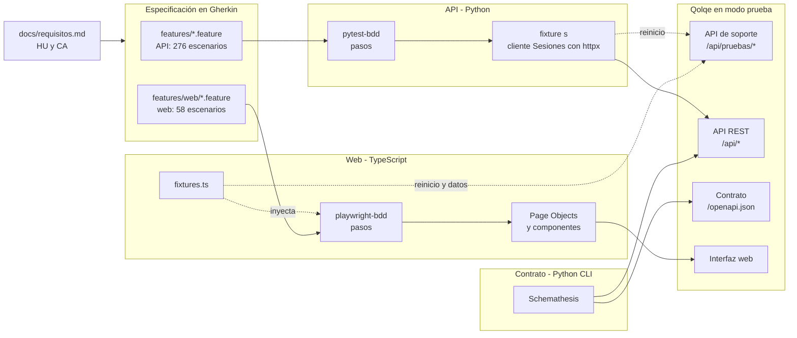
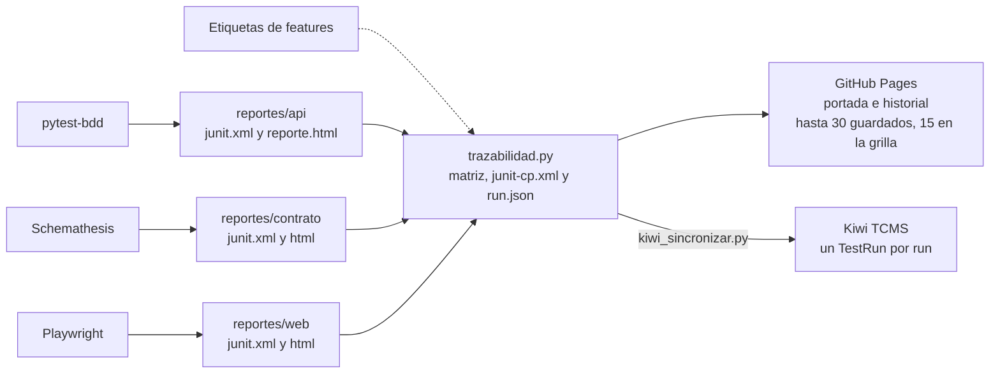
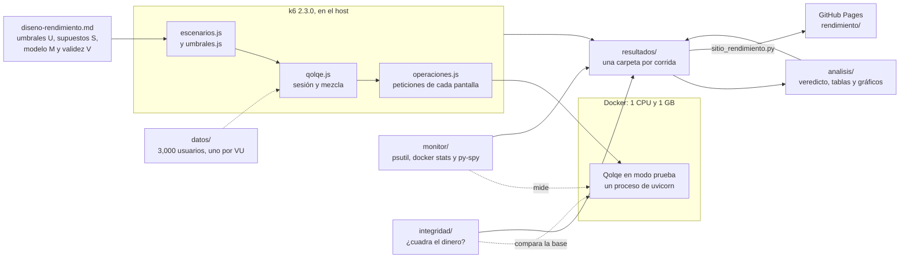
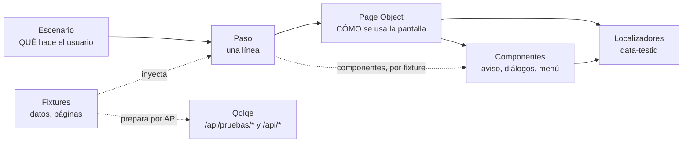

# Arquitectura de la automatización (API, web y rendimiento), herramientas y patrón de diseño

Este documento atiende tres indicaciones de la entrega final: que la arquitectura del proyecto de automatización sea clara, que las herramientas sean complementarias y estén justificadas, y que el patrón de diseño se compare con otros, incluida su escalabilidad. Cubre las tres partes del consolidado: API, web con CI/CD y rendimiento. El pipeline se detalla en [`pipeline.md`](pipeline.md), la gestión de casos en [`gestion-casos.md`](gestion-casos.md) y la capacidad de IA en [`capacidad-ia.md`](capacidad-ia.md).

**En pocas líneas:** los criterios de aceptación se escriben en Gherkin y los ejecutan dos suites: API, en Python, y web, en TypeScript. Una tercera suite, de contrato, genera casos desde el OpenAPI de Qolqe. Las tres corren en el pipeline contra Qolqe sin modificarlo y entregan JUnit XML, que alimenta la trazabilidad, GitHub Pages y Kiwi TCMS. La Parte 3 mide el rendimiento con k6 contra Qolqe en un contenedor Docker de 1 CPU y 1 GB. Esas corridas se hacen a mano, fuera del pipeline (la sección 1.6 explica por qué), y su evidencia queda versionada en `tests/performance/resultados/`, desde donde el pipeline la publica en Pages.

| Tamaño en la entrega final (tag [`entrega-final-v1`](https://github.com/Joharjbe/qolqe-wallet/releases/tag/entrega-final-v1)) | API | Contrato | Web | Rendimiento (k6) |
|---|---|---|---|---|
| Escenarios Gherkin | 276 en 10 `.feature` | — (caso CP-T04) | 58 en 4 `.feature` | — (no usa Gherkin). 8 escenarios en `k6/escenarios.js`: los 4 tipos de prueba (carga, pico, estrés y resistencia), referencia, calibración, demo y una confirmación de capacidad opcional |
| Pruebas que ejecuta el runner | 766 (los esquemas se expanden) | 19 operaciones de `/openapi.json` | 71, por 3 repeticiones = 213 | Una corrida por escenario, a mano, con `tests/performance/correr.sh` |
| Definiciones de pasos | 266 | — | 139 | — |
| Run #24 en GitHub Actions (17-nov-2026, hora de Lima; push a `main` en `1025a78`, los 8 jobs en verde; matriz en [`trazabilidad.md`](trazabilidad.md)) | 707 passed y 59 xfailed estrictos | 1316 casos generados en verde (28 omitidos) | 213 passed: incluye las 3 repeticiones de CP-NW03, que falla como se espera (`@fail @DEF-18`); 0 inestables | No corre en el pipeline. El job `reportes` suma su evidencia al sitio y `publicar` la despliega en [Pages](https://joharjbe.github.io/qolqe-wallet/rendimiento/) |
| Última corrida local completa (11-nov-2026, verificación final) | 707 passed y 59 xfailed estrictos, iguales test por test en 4 corridas | 1373 casos generados en verde (el número varía por la fase *stateful*) | 210 passed y 3 fallos esperados (CP-NW03, `@fail @DEF-18`), 0 inestables | 8 corridas en `tests/performance/resultados/` (los 4 tipos, referencia, calibración, estrés con 2 CPU y el ensayo de la demo) y 2 descartadas con su motivo. El dinero cuadra en las 8 (U-07) |
| Nivel y tipo de prueba (clases 3, 10 y 11: el nivel dice dónde se prueba y el tipo, qué atributo; son ortogonales) | Integración: la clase 10 llama a la prueba de API «la forma más directa de probar la integración». Tipo funcional; los casos técnicos prueban además seguridad (autenticación, aislamiento, fuga de datos) | Integración. Tipo funcional: conformidad con el contrato | Sistema: E2E no es un nivel sino un alcance, que suele ir en el nivel de sistema (clase 11). Tipo funcional | Sistema. Tipo no funcional: eficiencia de desempeño (clase 11, «Sistema, no funcional») |

En total hay 335 casos: 334 escenarios más CP-T04, que es la corrida de contrato. Los conteos se comprueban con `pytest tests/api --collect-only -q`, `npx playwright test --list` y `python .github/scripts/trazabilidad.py --verificar`. Los escenarios de k6 son las claves de `ESCENARIOS` en `tests/performance/k6/escenarios.js`, y las corridas se listan con `git ls-files tests/performance/resultados`. El job `estatico` no está en la tabla porque no es un nivel: es prueba estática del código de prueba y del workflow, sin ejecutarlos (clase 4).

---
## 1. Arquitectura del proyecto de automatización

> **Regla de niveles (clase 11).** *Cada regla se prueba en el nivel más bajo donde se pueda detectar; por la interfaz solo van los recorridos críticos y lo que solo se ve en la pantalla.* Un criterio tiene caso web si lo que afirma solo se ve en la pantalla, si es un paso de un recorrido crítico que pasa por dinero o por el acceso, o si la interfaz debe comunicar un error de la API. Con esa regla, 48 de los 51 criterios tienen caso web. Los 3 que no lo tienen son dos SMS (HU-N-01 CA6 y HU-N-05 CA3), que no aparecen en la pantalla, y la concurrencia (HU-N-07 CA5), que no se puede provocar de forma determinista desde la interfaz. El detalle por criterio está en [`alcance-y-casos.md`](alcance-y-casos.md). El rendimiento queda fuera de esta regla porque es otro tipo de prueba: nivel sistema, tipo no funcional (clase 11). No comprueba una regla: mide cuánta carga aguanta Qolqe (1.6).

### 1.1 Capas

| Capa | Qué responde | Dónde está |
|---|---|---|
| 1. Requisitos | ¿Qué debe hacer Qolqe? | [`requisitos.md`](requisitos.md): HU-N-01..09 (núcleo) y HU-G4-01..10, con sus CA y reglas |
| 2. Especificación | ¿Con qué ejemplos se comprueba cada CA? | `features/*.feature` (API) y `features/web/*.feature` (web), en español (`# language: es`). Cada escenario lleva `@HU-…`, `@CA…`, `@CP-…` y, si aplica, `@DEF-…` y `@tecnico`. En la web, un defecto conocido lleva además `@fail`. El ID del caso va también al inicio del título. |
| 3. Pasos | ¿Qué código ejecuta cada frase? | API: `tests/api/conftest.py` y `tests/api/pasos_*.py` (pytest-bdd). Web: `tests/e2e/steps/*.steps.ts` (playwright-bdd). |
| 4. Acceso a Qolqe | ¿Cómo se habla con el sistema? | API: fixture `s`, que entrega el cliente `Sesiones` (httpx con el token de cada usuario y la última respuesta). Web: fixtures que entregan Page Objects y componentes (`tests/e2e/pages/`), que usan los localizadores de Playwright. Los datos web se preparan con `DatosPrueba`, que usa el cliente HTTP de Playwright. |
| 5. Sistema bajo prueba | — | `qolqe/` sin cambios, levantado con `QOLQE_MODO_PRUEBA=1` y una base SQLite propia por suite |

El contrato no pasa por Gherkin: Schemathesis lee `/openapi.json` y genera los casos. Su alcance y sus exclusiones están en `scripts/correr-contrato.sh`, `schemathesis.toml` y `scripts/contrato_hooks.py`. El rendimiento tampoco pasa por Gherkin y tiene su propia cadena de capas, en 1.6.



### 1.2 Datos independientes en cada escenario

Todas las suites comparten la semilla de Qolqe (`qolqe/semilla.py`) y la API de soporte. Esa API solo existe en modo prueba (`qolqe/api/soporte_pruebas.py`). La automatización usa estas operaciones:

| Operación | Para qué | Quién la usa |
|---|---|---|
| `POST /api/pruebas/reiniciar` | Restaurar los datos semilla | Antes de cada escenario: fixture `s` (API) y fixture automática `datos` (web). Una vez al inicio: `correr-contrato.sh`. |
| `GET`, `PUT` y `DELETE /api/pruebas/reloj` | Ver, fijar o adelantar la hora, y volver a la real | Vencimientos, bloqueos y límites diarios. Las fixtures vuelven a la hora real antes y después de cada escenario. |
| `PUT /api/pruebas/saldo` | Fijar el saldo de un usuario | Pasos `Dado` que fijan un saldo: consulta, transferencias y cierre de cuenta |
| `GET /api/pruebas/notificaciones` | Leer los SMS simulados | CA que exigen enviar un SMS, o que no se envíe |

Reglas que se derivan:

- **Independencia (FIRST).** Ningún escenario depende de otro. Cada escenario web ingresa por la pantalla de login. La sesión no se reutiliza con `storageState` porque Qolqe la guarda en `sessionStorage`, que Playwright no persiste ([Playwright, Authentication](https://playwright.dev/docs/auth)).
- **Preparar por API, verificar por pantalla.** Lo que un escenario web necesita de antemano (contactos, solicitudes, transferencias, saldo, intentos fallidos) lo crea `DatosPrueba` por HTTP en milisegundos, no recorriendo otras pantallas. Es el uso que propone Playwright para su cliente de API ([API testing](https://playwright.dev/docs/api-testing)) y la recomendación de la clase 11 contra el entorno inestable. Cuatro Entonces verifican una postcondición del servidor por la API: ver [Convenciones de Gherkin](alcance-y-casos.md#convenciones-de-gherkin).
- **Un solo worker en la web.** Las pruebas comparten una base que se reinicia, así que `playwright.config.ts` fija `workers: 1` y `fullyParallel: false`.
- **Bases separadas en CI.** Los jobs `api` y `contrato` corren en runners distintos, cada uno con su propia base (`datos/api.db` y `datos/contrato.db`). La web usa `.demo-data/e2e.db`.

### 1.3 Cómo corre cada suite

| | API funcional y técnica | Contrato | Web E2E |
|---|---|---|---|
| Comando local | `npm run test:api` (pytest con JUnit y HTML) | `./scripts/correr-contrato.sh` | `npm run test:web` o `npm run test:web:3x` (`bddgen` y luego `playwright test`) |
| Job en CI | `api`, después de `contrato` | `contrato`, al inicio, después de `estatico` | `web`, solo si `api` y `contrato` están en verde |
| Cómo se levanta Qolqe en CI | Un paso del job con uvicorn | Un paso del job con uvicorn | `webServer` de Playwright lo levanta si no está corriendo (`reuseExistingServer: true`) |
| Cómo se descubren los casos | Cada `test_*.py` llama a `scenarios("<archivo>.feature")` | `--include-path-regex` con las operaciones del núcleo y G4: 20 coinciden y se excluye `DELETE /api/seguridad/sesiones` (HU-G6-10) | `bddgen` genera los `.spec.js` en `.features-gen/` desde `features/web/*.feature` |
| Defectos conocidos | `@DEF-xx` se convierte en `xfail(strict=True, raises=AssertionError)` con el hook `pytest_bdd_apply_tag` de `conftest.py`. Si el defecto se corrige, la prueba falla y avisa; un error que no es una aserción (servidor caído, paso roto) es un fallo, no el defecto. | Checks u operaciones desactivados con su motivo en `schemathesis.toml`; dos fallos descartados por valor en `contrato_hooks.py` (DEF-29 y un falso positivo) | `@fail @DEF-xx`: playwright-bdd lo traduce a `test.fail()`, que falla si la prueba pasa. Lo que el paso necesita para comparar es una precondición (`tests/e2e/precondicion.ts`): si no se cumple, el caso falla de verdad |
| Repetibilidad | Datos reiniciados por escenario; en las corridas locales del 11-nov-2026 se compararon 4 corridas caso por caso y salieron iguales | `--seed 42 --max-examples 30` | `--repeat-each=3`; en CI, `retries: 1` y `failOnFlakyTests: true` ponen el run en rojo si una prueba alterna |
| Evidencia (`EVIDENCIA`) | `tests/api/evidencia.py` adjunta peticiones y respuestas, con el token enmascarado: de cada caso, o solo de fallos y xfail | Con `con-imagenes`, además `peticiones.har` | Con `con-imagenes`: captura, video y traza de cada prueba. Sin imágenes: captura y traza de los fallos, video en el reintento. |

### 1.4 Dónde quedan los resultados

| Resultado | Lo produce | Dónde queda |
|---|---|---|
| JUnit XML de cada suite (formato común) | pytest, Schemathesis, Playwright | `reportes/api/junit.xml`, `reportes/contrato/junit.xml`, `reportes/web/junit.xml` |
| HTML con el detalle | pytest-html, Schemathesis, reporte HTML de Playwright | `reportes/api/reporte.html`, `reportes/contrato/html/`, `reportes/web/html/` |
| Resumen en la página del run | `.github/scripts/resumen.py` en cada job; tabla del job `quality-gate`; matriz del job `reportes` | Resumen del run en GitHub Actions |
| Artefactos del run | `actions/upload-artifact` | `reportes-api`, `reportes-contrato`, `reportes-web` y `sitio`: 14 días, o 7 si son con imágenes. `trazabilidad`: 90 días. |
| Matriz HU → CA → CP → resultado, JUnit con un caso por CP, `run.json` y evidencias por CP | `.github/scripts/trazabilidad.py` y `casos.py` (job `reportes`) | Artefactos `sitio` y `trazabilidad` |
| Portada, reportes e historial (hasta 30 runs en `historial.json`, 15 en la grilla de `historial.html`) | Job `publicar` (solo `main`) | GitHub Pages: `index.html`, `historial.html`, `historial.json` |
| Evidencia de rendimiento (Parte 3) | `.github/scripts/sitio_rendimiento.py` en el job `reportes`, con lo versionado en `tests/performance/resultados/` | GitHub Pages: `rendimiento/` |
| Historial por caso, requisito y defecto | `scripts/kiwi_sincronizar.py` con `kiwitcms-junit.xml-plugin` | Kiwi TCMS (`herramientas/kiwi/`): un TestRun por run de GitHub ([`gestion-casos.md`](gestion-casos.md)) |



### 1.5 Árbol del código de automatización

Solo se listan archivos versionados (`git ls-files`). Se omiten `qolqe/` (el sistema bajo prueba), `docs/`, `labs/` y los `.gitignore` y `.gitkeep`. Las carpetas con muchos archivos van en una línea.

```
qolqe-wallet/
├── README.md, IA.md                            # Portada del repositorio y declaración de uso de IA
├── features/                                   # Especificación en Gherkin
│   ├── nucleo_registro_api.feature             # HU-N-01
│   ├── nucleo_sesion_api.feature               # HU-N-02 y 03
│   ├── nucleo_cuenta_api.feature               # HU-N-04 y 05
│   ├── nucleo_dinero_cierre_api.feature        # HU-N-06
│   ├── nucleo_dinero_qolqe_api.feature         # HU-N-07
│   ├── nucleo_dinero_interbancaria_api.feature # HU-N-08
│   ├── nucleo_dinero_comision_api.feature      # HU-N-09
│   ├── contactos_api.feature                   # HU-G4-01..05
│   ├── solicitudes_api.feature                 # HU-G4-06..10
│   ├── g4_tecnico_api.feature                  # Casos técnicos CP-T de G4
│   └── web/
│       ├── nucleo_acceso_web.feature           # HU-N-01..05
│       ├── nucleo_dinero_web.feature           # HU-N-06..09
│       ├── contactos_web.feature               # HU-G4-01..05
│       └── solicitudes_web.feature             # HU-G4-06..10
├── tests/
│   ├── api/                                    # Python: pytest + pytest-bdd + httpx
│   │   ├── test_contactos_api.py, test_solicitudes_api.py, test_g4_tecnico_api.py,
│   │   │   test_nucleo_acceso_api.py, test_nucleo_dinero_api.py   # scenarios("…feature")
│   │   ├── conftest.py                         # Fixture s (Sesiones), @DEF → xfail estricto, pasos comunes y de G4
│   │   ├── pasos_nucleo_acceso.py              # Pasos HU-N-01..05
│   │   ├── pasos_nucleo_dinero.py              # Pasos HU-N-06..09
│   │   ├── pasos_g4_extra.py                   # Pasos extra de G4, incluida la validación contra OpenAPI
│   │   └── evidencia.py                        # Peticiones y respuestas en reporte.html
│   ├── e2e/                                    # TypeScript: Playwright Test + playwright-bdd
│   │   ├── fixtures.ts                         # datos (automática), DatosPrueba, Page Objects, componentes,
│   │   │                                       #   otroNavegador y peticiones
│   │   ├── precondicion.ts                     # En un caso @fail, la precondición que no se cumple falla de verdad
│   │   ├── pages/
│   │   │   ├── componentes.ts                  # Aviso, DialogoConfirmacion, DialogoFormulario, ListaVacia, Navegacion
│   │   │   ├── PaginaQolqe.ts                  # Base de un nivel para las pantallas con menú
│   │   │   ├── LoginPage.ts, RegistroPage.ts   # Sin menú: no heredan de PaginaQolqe
│   │   │   └── InicioPage.ts, PerfilPage.ts, TransferirPage.ts, ContactosPage.ts, SolicitudesPage.ts
│   │   ├── steps/                              # comunes, nucleo_acceso, nucleo_dinero, contactos, solicitudes
│   │   └── tsconfig.json                       # Para tsc --noEmit (job estatico)
│   ├── performance/                            # Parte 3: rendimiento con k6
│   │   ├── README.md                           # Estructura, entorno, cómo correr y qué deja cada corrida
│   │   ├── preparar.sh, correr.sh              # Imagen, datos y base del día; una corrida completa con su evidencia
│   │   ├── requirements.txt                    # psutil, numpy, pandas y matplotlib, con versión fijada (host)
│   │   ├── k6/                                 # qolqe.js, operaciones.js, escenarios.js, umbrales.js, resumen.js,
│   │   │                                       #   correr_k6.sh y README.md
│   │   ├── docker/                             # Dockerfile (imagen qolqe-perf:p3), Dockerfile.dockerignore, versiones.txt,
│   │   │                                       #   config.env (CPUS=1, MEMORIA=1g, puerto 8090) y comun.sh
│   │   ├── datos/                              # preparar_datos.py y preparar_bd.sql (3,000 usuarios); usuarios.csv
│   │   ├── monitor/                            # monitor.py (psutil), monitor_docker.py (docker stats), corrida.py
│   │   ├── integridad/                         # U-07: verificar.py, verificar_bd.py, foto.sql y verificar_dinero.sql
│   │   ├── analisis/                           # 18 módulos de Python y README.md: veredicto, tablas y gráficos;
│   │   │                                       #   config.py guarda todos los valores
│   │   └── resultados/                         # Evidencia del 11-nov: 8 corridas, 2 descartadas, entorno/ y comparativo/
│   ├── diagnostico/                            # Validación de la capacidad de IA: conftest.py, 7 test_*.py y
│   │                                           #   conjunto_oro/ (casos etiquetados, cada uno con su fuente)
│   └── test_humo.py                            # Humo de la app con TestClient (fuera del pipeline)
├── herramientas/
│   ├── kiwi/                                   # docker-compose de Kiwi TCMS y generar-certificado.sh (certificado local)
│   ├── diagnostico_ia/                         # Capacidad de IA: diagnóstico de los fallos de un run (capacidad-ia.md)
│   └── mediciones/                             # CP-T19: cp_t19.py, aceptar frente a cancelar o rechazar a la vez (manual, DEF-30)
├── scripts/
│   ├── correr-contrato.sh, contrato_hooks.py   # Contrato: alcance, token y filtros por valor
│   ├── kiwi_sincronizar.py                     # Runs de GitHub → TestRuns de Kiwi
│   └── preparar-demo.sh                        # Demo en vivo
├── .github/
│   ├── workflows/pruebas.yml                   # estatico, api, contrato, web, quality-gate, reportes,
│   │                                           #   gestion-casos, publicar
│   └── scripts/                                # casos.py y trazabilidad.py (modelo de casos, matriz e historial),
│                                               #   resumen.py (resumen del job), sitio_rendimiento.py (Parte 3 en Pages)
├── playwright.config.ts, package.json, package-lock.json   # Runner web, reportes y evidencia según EVIDENCIA
├── pytest.ini, schemathesis.toml, ruff.toml    # Runner de API, exclusiones del contrato, lint
├── ejemplo.env                                 # Plantilla del .env de la capacidad de IA (la clave no se versiona)
└── requirements*.txt, constraints.txt          # Dependencias fijadas de API, contrato y Kiwi (FastAPI 0.117.1, ver DEF-07)
```

### 1.6 Rendimiento (Parte 3)

La Parte 3 responde otra pregunta. No comprueba si una regla se cumple: mide cuánta carga aguanta Qolqe dentro del SLA y dónde se rompe. Por eso no pasa por Gherkin y tiene su propia cadena de capas, paralela a la de 1.1. Todo está en `tests/performance/`, y su [`README.md`](../tests/performance/README.md) dice cómo repetirlo.

| Capa | Qué responde | Dónde está |
|---|---|---|
| 1. Requerimiento | ¿Qué carga y qué tiempos exige el negocio? | Umbrales U, supuestos S, modelo de carga M y criterios de validez V en [`diseno-rendimiento.md`](diseno-rendimiento.md), §2 y §3. Cada valor del código lleva en un comentario el ID del que sale. |
| 2. Escenarios y umbrales | ¿Con qué carga se prueba y cuándo se da por fallado? | `k6/escenarios.js` (los 8 escenarios y sus fases) y `k6/umbrales.js` (U-01 a U-06 como umbrales de k6). La sesión y la mezcla están en `k6/qolqe.js`; las peticiones de cada pantalla, en `k6/operaciones.js`. |
| 3. Entorno | ¿Dónde corre Qolqe para que la medición se pueda repetir? | `docker/`: imagen `qolqe-perf:p3` con las mismas versiones que el `.venv` y un contenedor con `--cpus=1 --memory=1g` (`config.env`). k6 corre en el host, en la misma Mac. |
| 4. Datos | ¿Con qué usuarios? | `datos/`: 3,000 usuarios, uno por VU, con S/ 10,000, 5 contactos, 30 deudas y 1,000 movimientos cada uno. Se crean por la API de Qolqe y por SQL. |
| 5. Medición de recursos | ¿Por qué tarda? | `monitor/`: psutil sobre Qolqe y sobre k6, `docker stats` del contenedor y `corrida.json` con la cuota leída del cgroup. En el estrés, py-spy perfila Qolqe. |
| 6. Integridad | ¿El dinero cuadra después de la carga? | `integridad/`: compara la base antes y después y concilia con las respuestas 201 de k6 (U-07, chequeos C1 a C6). |
| 7. Análisis | ¿Pasó o falló cada umbral? | `analisis/`: veredicto por umbral antes de mirar gráficos, tablas por ventana y gráficos G1 a G11. |
| 8. Evidencia | ¿Dónde queda? | `resultados/<escenario>/<AAAAMMDD-HHMM>/`, versionada. El job `reportes` la copia al sitio con `.github/scripts/sitio_rendimiento.py`: [Pages, `rendimiento/`](https://joharjbe.github.io/qolqe-wallet/rendimiento/). |
| Sistema bajo prueba | — | `qolqe/` sin cambios, dentro del contenedor, con `QOLQE_MODO_PRUEBA=1` y un solo proceso de uvicorn |

`preparar.sh` arma la imagen, los datos y la base del día. `correr.sh <escenario>` pasa por las capas 2 a 8 en cada corrida: restaura la base, arranca el contenedor, comprueba la cuota, lanza los monitores y k6, verifica el dinero y analiza.



**Por qué no corre en el pipeline.** Es una decisión, no un olvido, y tiene tres razones:

- **La medición solo vale en condiciones controladas, y se comprueban en cada corrida.** `correr.sh` espera a que el equipo esté libre (V-04: CPU ocioso ≥ 65 %), lee la cuota del cgroup del contenedor (V-05: `cpu.max = 100000 100000` y `memory.max = 1073741824`) y registra el CPU de k6, que debe quedar bajo el 80 % (V-01). En un runner hospedado por GitHub no sabemos qué más usa la máquina física, así que V-04 no se podría afirmar.
- **El margen ya es corto en la misma Mac con el equipo libre.** Con 82.6 % de CPU ocioso, la referencia de 1 VU dio 92 ms en el login, frente a los 80 ms de V-06 (`tests/performance/resultados/referencia/20261111-1828/veredicto.md`). El informe lo acepta como limitación del entorno y da una causa probable: con 1 VU, el PBKDF2 del login corre en una vCPU casi ociosa que macOS programa en núcleos de eficiencia ([`Informe_Rendimiento_Qolqe.pdf`](Informe_Rendimiento_Qolqe.pdf), §6). Un margen de 12 ms que depende de cómo el sistema programa el PBKDF2, puesto como umbral en el quality gate, daría rojos que no son de Qolqe.
- **La duración.** Las corridas medidas duraron 19.1 min la carga, 21.0 el pico, 15.8 el estrés y 64.1 la resistencia (`state.testRunDurationMs` del `resumen.json` de cada una). El estrés estaba programado para 28 min más el drenaje ([README](../tests/performance/README.md), §4), pero lo cortó antes la red de seguridad técnica de k6 ([`informe.md`](informe.md), §4). El run #24 completo, con sus 8 jobs, tardó 13 min 38 s en el intento 1.

Lo que sí entra al pipeline es el resultado. La evidencia está versionada en `tests/performance/resultados/` y el job `reportes` la copia al sitio. El quality gate dice en su resumen que no evalúa el rendimiento. Un job de humo de k6 tampoco demostraría ningún umbral, por la primera razón, y por eso no se agregó.

---

## 2. Herramientas y por qué son complementarias

**Criterio.** Cada herramienta responde una pregunta que las demás no responden. Una herramienta nueva solo entra si cubre un hueco. Donde hay solapamiento, es a propósito y con otro oráculo. Por ejemplo, la API prueba la regla que produce un error, y la web prueba que ese error le llega al usuario.

| Capa | Herramienta (versión fijada) | Qué cubre que las otras no | Alternativas consideradas y por qué no |
|---|---|---|---|
| Especificación | Gherkin en español, leído por pytest-bdd y por playwright-bdd | Un solo formato y las mismas etiquetas para API y web: el CA y el caso se leen igual en los dos niveles, y `trazabilidad.py` los une con los JUnit | **Karate:** su Gherkin trae los pasos ya implementados, pero su propio README marca *Readable Specification: No* y lo describe como un mini lenguaje de programación ([README, Cucumber vs Karate](https://github.com/karatelabs/karate/blob/v1.5.2.RC2/README.md#cucumber-vs-karate)). Los `.feature` dejarían de leerse como criterios de aceptación. |
| API funcional y técnica | pytest 8.4.2, pytest-bdd 9.0.0, httpx (0.28.1 instalado), pytest-html 4.2.0 | Reglas de negocio por CA: valores límite, particiones, estados, permisos, formato de error, 401 y 404. Además: concurrencia con hilos sincronizados (`threading.Barrier`), validación de respuestas puntuales contra el esquema OpenAPI (`jsonschema-rs`, fijado en `requirements-dev.txt`), defectos como xfail estricto y fixtures de pytest ([fixtures](https://docs.pytest.org/en/stable/explanation/fixtures.html)) | **Postman + Newman:** Postman indica que Newman ya no recibirá actualizaciones ni correcciones y pide migrar a Postman CLI ([Postman](https://learning.postman.com/docs/collections/using-newman-cli/command-line-integration-with-newman/)). Sus pruebas son JavaScript dentro de la colección, sin Gherkin compartido. **Bruno:** colecciones en texto versionable, con JS o un DSL propio (clase 10); tampoco ejecuta Gherkin. **REST Assured:** DSL de Java ([rest-assured.io](https://rest-assured.io/)); sumaría un tercer lenguaje y la JVM. **Robot + RequestsLibrary:** palabras clave, no `.feature` (clase 10). **Cliente HTTP de Playwright:** su documentación lo propone para probar la API, preparar estado y validar postcondiciones, y no trae validación de esquema ([API testing](https://playwright.dev/docs/api-testing)). Lo usamos para preparar datos web. Para la suite de API no aporta nada que falte en pytest y obligaría a reescribir 266 pasos. |
| Contrato | Schemathesis 4.32.7 (CLI) | Casos que nadie escribió, generados desde `/openapi.json` (OpenAPI 3.1.0) en cuatro fases: ejemplos, cobertura, fuzzing y secuencias con estado. Comprueba propiedades como "ninguna respuesta es 500" o "toda respuesta cumple su esquema". Así aparecieron DEF-05, DEF-06, DEF-08 y DEF-29. Su artículo reporta de 1.4 a 4.5 veces más defectos únicos que el segundo mejor fuzzer ([Hatfield-Dodds y Dygalo](https://arxiv.org/abs/2112.10328)). No conoce reglas de negocio: complementa a pytest-bdd, no lo reemplaza. | **Dredd:** repositorio archivado el 8 de noviembre de 2024 y soporte de OpenAPI 3 experimental ([GitHub](https://github.com/apiaryio/dredd)). **Pact:** contratos guiados por el consumidor. Su documentación dice que no sirve para la prueba funcional del proveedor ni para APIs cuyos consumidores no se identifican uno por uno ([Pact](https://docs.pact.io/getting_started/what_is_pact_good_for)). Además, no se puede tocar `qolqe/`. |
| Web E2E | Playwright Test 1.64.1, playwright-bdd 9.2.1, TypeScript 5.9.3 (Chromium) | Lo que solo se ve en pantalla (mensajes, máscaras, pestañas, estados de botones), recorridos críticos y que el error de la API llegue al usuario. Espera automática antes de cada acción; aserciones que reintentan; traza, captura y video; `repeatEach`, `retries` y `failOnFlakyTests` ([TestConfig](https://playwright.dev/docs/api/class-testconfig)); `webServer`; varios contextos aislados en una prueba (CP-NW18 cierra la cuenta y comprueba la sesión en "otro navegador") | **Selenium WebDriver:** la espera implícita vale 0 por defecto y su guía advierte no mezclar esperas implícitas y explícitas ([Waits](https://www.selenium.dev/documentation/webdriver/waits/)). No trae runner ni reporte. **Cypress:** solo JavaScript, corre dentro del navegador y no controla más de un navegador a la vez ([Trade-offs](https://docs.cypress.io/app/references/trade-offs)); CP-NW18 necesita dos sesiones. **Robot Framework + Browser:** corre sobre Playwright y también espera sola ([robotframework-browser.org](https://robotframework-browser.org/)), pero no ejecuta `.feature`. Lo usamos en el laboratorio S11 (`labs/s11-robot/`). **WebdriverIO:** usa WebDriver BiDi por defecto ([Protocols](https://webdriver.io/docs/automationProtocols)); es válido, pero no aporta nada que falte aquí. |
| Rendimiento (Parte 3) | k6 2.3.0, instalado con Homebrew y fijado con `brew pin` | El requerimiento da la carga como tasa de llegada (3,000 sesiones por hora) y pide sostenerla "sin acumular retrasos". k6 la modela con ejecutores de llegada (modelo abierto): si Qolqe se pone lento, no baja la carga y cuenta las sesiones que no pudo iniciar (`dropped_iterations`) ([modelo abierto](https://grafana.com/docs/k6/latest/using-k6/scenarios/concepts/open-vs-closed/), [dropped iterations](https://grafana.com/docs/k6/latest/using-k6/scenarios/concepts/dropped-iterations/)). Los umbrales del SLA van en el script y k6 termina con código 99 si alguno falla ([thresholds](https://grafana.com/docs/k6/latest/using-k6/thresholds/), [código de salida](https://grafana.com/docs/learning-paths/automate-k6-cicd/handle-exit-code/)). pytest-bdd y Playwright comprueban reglas caso por caso: no generan carga sostenida ni dan percentiles bajo carga. k6 no mide el CPU ni la memoria del servidor; para eso está la fila siguiente. | **JMeter** (laboratorio S13): su modelo abierto es experimental ([BlazeMeter](https://www.blazemeter.com/blog/open-model-thread-group)) y termina con código 0 aunque haya fallas ([BlazeMeter](https://www.blazemeter.com/blog/jmeter-github-testing)). **Gatling:** no pone umbral al retraso acumulado ([Assertions](https://docs.gatling.io/concepts/assertions/)). **Locust:** población fija de usuarios, sin modelo abierto ([locustfile](https://docs.locust.io/en/stable/writing-a-locustfile.html)). **Artillery:** solo cuenta las sesiones que no pudo iniciar si se fija `maxVusers` ([Reported metrics](https://www.artillery.io/docs/reference/reported-metrics)). **Taurus:** orquesta otra herramienta, con modelo cerrado y tope de throughput ([Execution settings](https://gettaurus.org/docs/ExecutionSettings/)). La comparación completa, con sus fuentes, está en [`Informe_Rendimiento_Qolqe.pdf`](Informe_Rendimiento_Qolqe.pdf), §2. |
| Medición de recursos y perfilado | psutil 7.2.2, `docker stats` (Docker Desktop, motor 29.8.2), py-spy 0.4.3 | k6 mide desde fuera: ve cuánto tarda Qolqe, no por qué. psutil registra cada segundo el CPU, la memoria (RSS), los hilos y los descriptores del proceso de Qolqe, y también el CPU de k6, que debe quedar bajo el 80 % para que la corrida valga (V-01) ([psutil](https://psutil.readthedocs.io/en/stable/)). `docker stats` da el consumo del contenedor frente a su cuota ([docker stats](https://docs.docker.com/reference/cli/docker/container/stats/)). py-spy toma muestras de la pila de Qolqe sin reiniciarlo ni modificar su código ([py-spy](https://github.com/benfred/py-spy)). Junto con el log de Qolqe, ubicó el cuello de botella en la escritura de la sesión en SQLite durante el login (`autenticacion.py:136`, [`informe.md`](informe.md) §4). | No se evaluaron alternativas. El enunciado de la Parte 3 trae el script de psutil y `monitor/monitor.py` lo adapta. py-spy se eligió porque perfila desde fuera del proceso, y `qolqe/` no se puede tocar. |
| Entorno controlado | Docker con `--cpus=1 --memory=1g --memory-swap=1g`; imagen `qolqe-perf:p3` con Python 3.11 y las mismas versiones que el `.venv` (FastAPI 0.117.1) | La cuota separa el CPU de Qolqe del de k6, que queda con 9 núcleos libres en la misma Mac: la herramienta no compite con la aplicación y el estrés sí llega al límite. Docker aplica los límites en el cgroup del contenedor ([resource constraints](https://docs.docker.com/engine/containers/resource_constraints/)), y `correr.sh` comprueba en cada corrida `cpu.max = 100000 100000` y `memory.max = 1073741824` (V-05). Es lo que hace repetible una medición hecha en una laptop. | **Local, sin contenedor:** Qolqe tendría los 10 núcleos y competiría con k6. **Dos equipos:** no hay una segunda laptop. **Codespaces:** suma la latencia de internet, que no se puede aislar, y es un entorno compartido. La comparación está en [`diseno-rendimiento.md`](diseno-rendimiento.md), §6.1. |
| Calidad del código de prueba | ruff 0.17.1, `tsc --noEmit`, `bddgen`, `pytest --collect-only`, `trazabilidad.py --verificar`, actionlint 1.7.12 y la regla del patrón con `grep` (job `estatico`) | Detecta en segundos, sin servidor, lo que rompería todas las suites: paso sin definir, error de tipos, etiqueta `@CP` repetida, par `@HU @CA` inexistente, un workflow mal encadenado o un paso con localizadores (3.1). Playwright no revisa tipos y recomienda correr `tsc` aparte ([TypeScript](https://playwright.dev/docs/test-typescript)). actionlint revisa el YAML del workflow antes de gastar un runner ([actionlint](https://github.com/rhysd/actionlint)). | Sin alternativa relevante: son verificaciones baratas que no compiten con nada |
| Orquestación y quality gate | GitHub Actions (`.github/workflows/pruebas.yml`) | Ejecuta todo en cada push y PR. `api` y `web` son checks obligatorios de `main` (al 18-nov-2026; `quality-gate` da el veredicto único, pero no es obligatorio), y el sitio se publica en Pages sin servidor propio. | **Jenkins:** exige mantener un servidor y agentes. **GitLab CI:** exige migrar el repositorio (clase 12). El detalle de cada job está en [`pipeline.md`](pipeline.md). |
| Evidencia de un run | JUnit XML (formato común), HTML de cada herramienta, resumen del job | JUnit es lo único que las tres suites escriben igual: lo leen la matriz, el resumen y Kiwi. El HTML da el detalle propio de cada nivel: peticiones en API, HAR en contrato, trazas en web. | **Allure Report:** tiene adaptadores para pytest y Playwright ([Allure](https://allurereport.org/docs/playwright/)). Agregaría un cuarto formato que repite lo que ya dan JUnit, la portada y Kiwi. |
| Trazabilidad entre ejecuciones | `trazabilidad.py` + `casos.py` (propios), historial en GitHub Pages | Lee nuestras etiquetas (`@HU`, `@CA`, `@CP`, `@DEF`, `@tecnico`) y los JUnit de las tres suites. Marca `flaky` cuando un caso alterna en sus repeticiones, guarda hasta los últimos 30 runs en `historial.json` y dibuja la grilla de los últimos 15. | La matriz versionada de la Entrega 2 (`docs/trazabilidad.md`) muestra un solo run (#10). Los artefactos y runs de GitHub vencen, por defecto a los 90 días. |
| Gestión de casos | Kiwi TCMS CE 17.0 en Docker; `tcms-api` 15.0 y `kiwitcms-junit.xml-plugin` 15.0 | Casos, planes, un TestRun por run, versión (commit), requisito (HU), defecto (DEF) y adjuntos, sin límite de usuarios ni de historial | **Qase Free, TestRail, Xray, Zephyr, QMetry, Testmo, Allure TestOps y TestLink:** la comparación está en [`gestion-casos.md`](gestion-casos.md). Kiwi es el TCMS open source que presenta la semana 12. |

### ¿Por qué Python y TypeScript?

La respuesta corta: cada capa usa el runner que mejor la resuelve, en el lenguaje en que el curso lo enseña. El precio es real y lo pagamos a sabiendas.

- **Python para API y contrato.**
  - Qolqe está escrito en Python (FastAPI) y la clase 10 enseña pytest + httpx + pytest-bdd + Schemathesis.
  - pytest aporta fixtures, parametrización (con los Esquemas del escenario, 276 escenarios se convierten en 766 pruebas) y hooks: con `pytest_bdd_apply_tag` cada `@DEF` queda como xfail estricto, y `evidencia.py` registra las peticiones en el HTML.
  - Schemathesis es Python y se usa por línea de comandos, así que no depende del lenguaje de las pruebas.
- **TypeScript para la web.**
  - La clase 11 enseña Playwright + playwright-bdd en TypeScript.
  - El runner Playwright Test es de Node. En Python, Playwright se usa con el plugin de pytest, que documenta trazas, capturas, video y paralelo con xdist, pero no reintentos ni repeticiones ([Playwright para Python](https://playwright.dev/python/docs/test-runners)). Para tenerlos habría que sumar pytest-rerunfailures y pytest-repeat.
  - Playwright Test trae integrado lo que usamos: fixtures inyectadas por nombre, `repeatEach`, `retries` con `failOnFlakyTests`, `webServer`, `test.fail()` y reporte HTML con trazas.
- **Lo que comparten las capas son artefactos, no código.** Comparten el Gherkin con sus etiquetas, la API de soporte, la semilla y el formato JUnit. La frontera del lenguaje coincide con la frontera de la capa: ningún archivo de una suite importa algo de la otra. La Parte 3 sigue la misma regla: sus scripts son JavaScript que ejecuta el propio k6 y su análisis es Python, y nada de `tests/performance/` importa código de las suites funcionales; comparte con ellas la API de soporte y la semilla.
- **Lo que cuesta.**
  - Dos gestores de dependencias (pip con `constraints.txt` y npm con `package-lock.json`), y el job `web` instala ambos porque necesita Python para levantar Qolqe.
  - La Parte 3 suma dos archivos de versiones más: `tests/performance/requirements.txt` (psutil, numpy, pandas y matplotlib, en el host) y `tests/performance/docker/versiones.txt` (21 versiones fijadas para la imagen de medición, entre ellas psutil y py-spy). k6 se instala aparte, con Homebrew.
  - Usuarios de prueba repetidos en `tests/api/conftest.py` y `tests/e2e/fixtures.ts`.
  - Dos sintaxis de pasos: `parsers.parse`/`parsers.re` y Cucumber Expressions.
- **¿Se podía usar un solo lenguaje?** Sí.
  - Todo en Python: pytest-bdd + pytest-playwright + pytest-rerunfailures + pytest-repeat. Es razonable para un proyecto que empieza de cero. No migramos porque habría que reescribir 139 pasos y 9 archivos de páginas, y perderíamos el reporte HTML del runner de Node, que integra trazas, capturas y video.
  - Todo en TypeScript: habría que reescribir 266 pasos de API y los hooks de pytest (xfail por etiqueta, evidencia de peticiones). Además, el cliente HTTP de Playwright no valida esquemas y habría que sumar una librería.

---

## 3. Patrón de diseño

### 3.1 Lo que implementamos

El patrón es **Page Object con componentes, una base de un solo nivel y fixtures**. Usa tres de los cuatro patrones de la clase 11: Page Object, Fixture y la idea del Test Data Builder (valores válidos por defecto, sin interfaz fluida). El cuarto, Screenplay, se compara en 3.3.

| Pieza | Archivo | Responsabilidad | Regla que se cumple |
|---|---|---|---|
| Escenario | `features/web/*.feature` | **Qué** hace y ve el usuario | Sin selectores ni detalles del HTML |
| Paso | `tests/e2e/steps/*.steps.ts` (139) | Traducir una frase a una llamada | Ningún localizador. Lo hace cumplir el job `estatico` con el `grep` que está debajo de la tabla |
| Fixtures | `tests/e2e/fixtures.ts` | Entregar por nombre los Page Objects y componentes que pide cada paso. Preparar y limpiar. | `datos` es automática: reinicia base y reloj antes de cada escenario y restaura el reloj después |
| Datos de prueba | `DatosPrueba` en `fixtures.ts` | Crear por HTTP contactos, solicitudes, transferencias, saldo e intentos fallidos | Rellena con valores por defecto (`Alias <nombre>`, `Zeta 01`…); el escenario solo dice lo que importa |
| Page Object | `LoginPage`, `RegistroPage`, `InicioPage`, `PerfilPage`, `TransferirPage`, `ContactosPage`, `SolicitudesPage` | **Cómo** se usa cada pantalla: acciones (verbos) y verificaciones (`esperar…`) | Es el único lugar, junto con los componentes, que conoce el HTML |
| Base | `PaginaQolqe.ts` | Dar `nav` a las pantallas con menú | Un solo nivel. `LoginPage` y `RegistroPage` no heredan porque no tienen menú. Ninguna pantalla hereda de otra. |
| Componentes | `componentes.ts`: `Aviso`, `DialogoConfirmacion`, `DialogoFormulario`, `ListaVacia`, `Navegacion` | Un objeto por cada widget que `qolqe/web/static/app.js` genera igual en todas las pantallas: `toast()`, `confirmar()`, `dialogoFormulario()`, `itemVacio()` y el menú `nav-<ruta>` | Las pantallas **componen** tres de ellos como campos: `Navegacion` (en `PaginaQolqe`), `DialogoConfirmacion` (`ContactosPage` y `SolicitudesPage`) y `DialogoFormulario` (esas dos y `PerfilPage`). `fixtures.ts` entrega los cinco directo a los pasos comunes (`fixtures.ts:176-180`). `Aviso` y `ListaVacia` solo llegan así, porque ninguna pantalla los compone (`comunes.steps.ts:40-41`). El diálogo propio de `/transferir` no es compartido y vive en `TransferirPage`. |
| Localizadores | Dentro de Page Objects y componentes | `getByTestId` con `testIdAttribute: 'data-testid'` | Sin clases de estilo ni `nth-child`. La posición solo se usa cuando es la regla ("el primer contacto es…"). Las excepciones están debajo de la tabla. |

El `grep` del job `estatico` (`.github/workflows/pruebas.yml`, paso «Regla del patrón») es este, y el job falla si encuentra algo:

```bash
grep -rnE "getBy|locator\(|page\." tests/e2e/steps
```

Hoy no devuelve ninguna línea, y en el run #24 ese paso terminó en verde. Para comprobar que la guarda detecta lo que debe, se pegó un `page.getByTestId(...)` en una copia de `tests/e2e/steps` fuera del repositorio: el mismo comando devolvió la línea (17-nov-2026).

**Excepciones a la regla de localizadores.** Qolqe crea las opciones de sus `<select>` sin `data-testid` (`app.js` las arma solo con valor y texto), así que esas opciones se buscan por su texto con `locator('option', { hasText })` (`TransferirPage.ts:70`, `SolicitudesPage.ts:20-21`). Y hay posiciones que no son la regla, sino sincronización: `TransferirPage.abrir()` espera la opción `.nth(1)` (`TransferirPage.ts:21`) porque la primera es el texto fijo «— Escribir un celular —» y la segunda solo existe cuando ya llegaron los contactos; `SolicitudesPage.abrir()` e `irAPestana()` esperan con `.first()` a que la lista muestre algo. Ninguna verifica qué hay en esa posición.

Fixtures adicionales: `otroNavegador` abre un contexto aislado con su propio `sessionStorage`, para la segunda sesión de CP-NW18 y CP-NW27. `peticiones` anota las peticiones que salen del navegador con su cuerpo, para las reglas que solo existen en la interfaz: el doble clic que debe enviar una sola petición (CP-W30) o el ingreso que debe enviar el dispositivo recordado (CP-NW08). `DatosPrueba` revisa cada respuesta de la API de soporte: si el reinicio falla, el escenario no corre con los datos del anterior.

**En la API no hay Page Objects.** El equivalente es el cliente `Sesiones` (fixture `s`), que oculta la URL base, el login, el token de cada usuario y la paginación. La ruta y el cuerpo HTTP sí aparecen en los pasos, a propósito: en una prueba de API la petición es lo que se prueba.

### 3.2 Del escenario al Page Object (código real, extractos)

Escenario (`features/web/solicitudes_web.feature`, CP-W10):

```gherkin
  @HU-G4-01 @HU-G4-06 @HU-G4-07 @CA1 @HU-G4-08 @CA3 @CP-W10
  Escenario: CP-W10 Recorrido completo de una solicitud entre dos usuarios
    # …
    Cuando cierra sesión e ingresa como "Bruno"
    Y abre la pantalla de solicitudes
    Y acepta la solicitud "Devolución demo G4"
    Entonces la solicitud "Devolución demo G4" está "Aceptada"
```

Pasos: cada uno es una línea y recibe sus objetos por fixture (`tests/e2e/steps/solicitudes.steps.ts` y `comunes.steps.ts`):

```ts
When('acepta la solicitud {string}', async ({ solicitudes }, motivo: string) => solicitudes.aceptar(motivo));
// …
Then('la solicitud {string} está {string}', async ({ solicitudes }, motivo: string, estado: string) => solicitudes.esperarEstado(motivo, estado));

When('cierra sesión e ingresa como {string}', async ({ nav, login }, nombre: string) => {
  await nav.cerrarSesion();
  await login.ingresar(USUARIOS[nombre].celular, USUARIOS[nombre].pin);
});
```

Page Object, que compone un componente (`tests/e2e/pages/SolicitudesPage.ts`):

```ts
export class SolicitudesPage extends PaginaQolqe {
  private readonly formulario = new DialogoFormulario(this.page);
  private readonly confirmacion = new DialogoConfirmacion(this.page);

  private filas = () => this.page.getByTestId('solicitud');
  private fila = (motivo: string) => this.filas().filter({ has: this.page.getByTestId('solicitud-motivo').getByText(motivo, { exact: true }) });
  // …
  async esperarEstado(motivo: string, estado: string) {
    await expect(this.fila(motivo).getByTestId('solicitud-estado')).toHaveText(estado);
  }
  // …
  async pulsarAceptar(motivo: string) {
    await this.fila(motivo).getByTestId('boton-aceptar-solicitud').click();
  }

  async aceptar(motivo: string) {
    await this.pulsarAceptar(motivo);
    await this.confirmacion.esperarMensaje(motivo);
    await this.confirmacion.confirmar();
  }
```

Componente compartido (`tests/e2e/pages/componentes.ts`) y su registro como fixture (`tests/e2e/fixtures.ts`):

```ts
/** Diálogo "¿Seguro?" con Confirmar y Cancelar. */
export class DialogoConfirmacion {
  constructor(private readonly page: Page) {}

  private raiz = () => this.page.getByTestId('dialogo-confirmar');

  async confirmar() {
    await this.raiz().getByTestId('boton-confirmar-accion').click();
  }
  // …
}

// fixtures.ts
  datos: [async ({ request }, use) => {
    const datos = new DatosPrueba(request);
    await datos.reiniciar();
    await use(datos);
    await request.delete('/api/pruebas/reloj');
  }, { auto: true }],
  // …
  solicitudes: async ({ page }, use) => use(new SolicitudesPage(page)),
```

Si cambia el diálogo de confirmación de Qolqe, se corrige `DialogoConfirmacion` y nada más. Lo usan `ContactosPage.eliminar`, `SolicitudesPage.aceptar` y `cancelar`, y los pasos "cancela la confirmación" y "la confirmación dice".



### 3.3 Comparación con otros patrones

**Qué propone cada uno**

| Patrón | Idea | Fuente |
|---|---|---|
| Sin patrón | Los pasos usan los localizadores directamente | Línea base de la clase 11 |
| Page Object clásico | Una clase por pantalla con sus localizadores y acciones; la prueba nunca toca el HTML | [Fowler (2013)](https://martinfowler.com/bliki/PageObject.html), [Selenium](https://www.selenium.dev/documentation/test_practices/encouraged/page_object_models/), [Playwright](https://playwright.dev/docs/pom) |
| **Page Object + componentes + fixtures (elegido)** | Lo anterior, más objetos para los fragmentos que se repiten y fixtures del runner que preparan datos e inyectan objetos | Fowler pide objetos "for the significant elements on a page", no solo por página. Selenium describe *page component objects* que se incluyen en los Page Objects. Ver [fixtures de Playwright](https://playwright.dev/docs/test-fixtures). |
| Page Factory | Campos anotados con `@FindBy`; `PageFactory.initElements` los convierte en proxies perezosos | [Selenium Java API](https://www.selenium.dev/selenium/docs/api/java/org/openqa/selenium/support/PageFactory.html) |
| Page Object fluido (encadenado) | Cada acción devuelve el Page Object siguiente para encadenar llamadas | Fowler: navegar "should return another page object"; [Fluent Interface](https://martinfowler.com/bliki/FluentInterface.html) |
| Screenplay | Actores con habilidades realizan tareas e interacciones y responden preguntas | [Smart, Marcano, Molak y Palmer (InfoQ, 2016)](https://www.infoq.com/articles/Beyond-Page-Objects-Test-Automation-Serenity-Screenplay), [Serenity/JS](https://serenity-js.org/handbook/design/screenplay-pattern/) |
| App Actions | La prueba llama a la lógica interna de la app, expuesta por ejemplo en `window`, en vez de preparar estado por la UI | [Bahmutov, Cypress (2019)](https://www.cypress.io/blog/stop-using-page-objects-and-start-using-app-actions) |
| Por palabras clave | La prueba es una secuencia de palabras clave reutilizables en tablas; el BDD se hace con prefijos Given/When/Then | [Robot Framework User Guide](https://robotframework.org/robotframework/latest/RobotFrameworkUserGuide.html), clase 11 |

**Evaluación con los criterios de la clase 11 para Qolqe** (58 escenarios web, 7 pantallas, 1 persona)

| Patrón | Tamaño de la suite | Cambios de la UI | Encaje con Gherkin y playwright-bdd | Lo que ya trae Playwright | Costo de adopción | Veredicto |
|---|---|---|---|---|---|---|
| Sin patrón | Solo para muy pocos escenarios | Un cambio toca todos los pasos que usan ese selector | Pasos con HTML adentro | — | Ninguno | No |
| Page Object clásico | Adecuado | Se corrige en un Page Object, pero el aviso, los diálogos y el menú quedarían repetidos en varias pantallas (el menú, en 5) | Bueno | Fixtures que entregan los Page Objects | Bajo | Insuficiente solo |
| **PO + componentes + fixtures** | **Adecuado** | **Un solo lugar: la pantalla o el componente** | **Pasos de una línea; un paso puede usar dos objetos** | **Usa fixtures, espera automática y aserciones con reintento** | **Bajo** | **Sí** |
| Page Factory | No aporta | Igual que Page Object | Igual que Page Object | Los localizadores de Playwright ya se resuelven en cada uso ("Every time a locator is used… an up-to-date DOM element is located", [Locators](https://playwright.dev/docs/locators)). No existe en Playwright. | Una capa sin beneficio | No |
| Fluido (encadenado) | Indiferente | Igual que Page Object | Cada paso es una función aparte que recibe sus objetos por fixture, así que la cadena se corta entre pasos. Con `async/await` cada eslabón necesita su propio `await`. | — | Bajo | No |
| Screenplay | Pensado para suites grandes; la clase 11 lo orienta a cientos de pruebas | Muy bueno: bajo acoplamiento | Con Cucumber, Serenity/JS corre los `.feature` con cucumber-js, no con Playwright Test ([Serenity/JS + Cucumber](https://serenity-js.org/handbook/test-runners/cucumber/)). Su integración con Playwright Test no menciona playwright-bdd ([Serenity/JS + Playwright Test](https://serenity-js.org/handbook/test-runners/playwright-test/)). | La espera y el registro de cada acción ya los da Playwright (traza) | Alto: actores, habilidades, tareas, interacciones y preguntas para 58 escenarios | No por ahora |
| App Actions | Solo resuelve la preparación | No modela la UI | — | — | Qolqe es multipágina y su estado vive en el servidor: no hay un modelo en el navegador al que llamar, y exponer uno exigiría modificar `qolqe/` | No. Tomamos su idea (no preparar por pantalla) con la API de soporte. |
| Por palabras clave (Robot + Browser) | Adecuado | Un solo lugar: el recurso con las palabras clave | Robot no ejecuta `.feature`: habría que traducir los 58 escenarios y dejar de compartir formato con la API | Browser corre sobre Playwright, pero con otro runner y otro reporte | Medio | No. Probado en `labs/s11-robot/`, con `.resource` como Page Objects. |

### 3.4 Justificación

Se aplican los cuatro criterios de la clase 11, cuya regla práctica es "empezar simple (Page Object + fixtures) y escalar solo cuando duela":

1. **Tamaño.** Son decenas de escenarios, no cientos, y los mantiene una persona. Eso orienta a Page Object. Screenplay agregaría actores, tareas y preguntas sin un problema que lo pida.
2. **Cambios de la UI.** Qolqe genera el aviso, los diálogos, la lista vacía y el menú desde las mismas funciones de `app.js`. Un componente por cada uno hace que un cambio se corrija en un solo archivo. Es lo que Fowler y Selenium llaman objetos de componente.
3. **BDD.** El Gherkin dice qué hace el usuario, el paso solo traduce y el Page Object dice cómo. Por eso los pasos no tienen localizadores.
4. **Lo que trae el framework.** Playwright ya espera, reintenta las aserciones y registra cada acción en la traza. Sus fixtures preparan, inyectan y limpian. No hace falta construir esa infraestructura con otro patrón.

En los términos del enunciado: la **mantenibilidad** sale del criterio 2, porque un cambio de Qolqe se corrige en un solo archivo (la pantalla o el componente). La **reutilización** está en los 5 componentes, en la base `PaginaQolqe`, que da el menú a 5 pantallas, y en `comunes.steps.ts`, con 20 pasos: 13 se usan en más de un `.feature` web y uno, "que … ingresó a Qolqe", en los cuatro. La **escalabilidad** se responde en 3.5 con lo que cuesta crecer.

### 3.5 Escalabilidad

La pregunta es qué cuesta crecer. Hoy la suite web tiene 58 escenarios (71 pruebas), 139 definiciones de pasos en 5 archivos, 7 pantallas con su Page Object, 5 componentes y ningún localizador en los pasos (lo verifica el job `estatico`, 3.1).

| Si entra… | Qué se escribe | Qué no se toca |
|---|---|---|
| Un módulo nuevo, como un G5 | Un `.feature` en `features/web/`, un archivo de pasos en `tests/e2e/steps/` y un Page Object por cada pantalla nueva. El runner toma los dos primeros por patrón (`playwright.config.ts:11-12`) | Los componentes, la base `PaginaQolqe`, los pasos de los otros módulos y la configuración |
| Una pantalla | Un Page Object que extiende `PaginaQolqe` si la pantalla tiene menú (así hereda `nav`) y tres cambios en `fixtures.ts`: el `import`, el tipo y la línea que la registra | Los componentes: si la pantalla tiene aviso, diálogos o lista vacía, los reutiliza tal cual |
| Un integrante | Su `.feature`, su archivo de pasos y sus Page Objects. Los pasos van por área, así que dos personas no editan el mismo archivo de pasos | Nada de lo ajeno. Lo compartido es el punto de choque en git: `componentes.ts`, `fixtures.ts` y `comunes.steps.ts` |

Lo que no escala igual de bien:

- **La trazabilidad conoce dos módulos.** El módulo sale del prefijo del caso (`casos.py:53`: `CP-N` es núcleo y el resto es G4), la lista de módulos y su grupo de JUnit están fijos (`MODULOS` y `GRUPO_JUNIT`, `casos.py:48-49`) y las HU se leen de `requisitos.md` con el patrón `HU-(?:N|G4)-` (`casos.py:65` y `:75`). Para un G5 hay que cambiar esas constantes y funciones de `casos.py` y sumar su sección "HU → caso → resultado" en `trazabilidad.py:553`. Si falta una, el síntoma cambia: sin el patrón, `trazabilidad.py --verificar` rechaza sus etiquetas con "no existe en docs/requisitos.md" (`trazabilidad.py:99`) aunque la HU esté escrita; sin `casos.py:53`, sus casos se cuentan en silencio como G4; sin `MODULOS`, el resumen por módulo no los muestra (`trazabilidad.py:147`); sin `GRUPO_JUNIT`, `trazabilidad.py:345` se cae al armar `junit-cp.xml`.
- **El techo real es la infraestructura, no el patrón.** `playwright.config.ts:19-21` fija `fullyParallel: false` y `workers: 1` porque todas las pruebas comparten una base que se reinicia en cada escenario. Con un solo worker, el tiempo crece con cada prueba que se suma: en el intento 1 del run #24, las 213 pruebas web tardaron 3.4 min (`213 passed (3.4m)` en el log del job `web`). La salida sería un Qolqe por worker, con su proceso y su base (el reloj de pruebas vive en la memoria del proceso). Es lo que ya se hace entre los jobs `api` y `contrato`, cada uno con su base (1.2).

Cuándo deja de bastar el patrón está en 3.7.

### 3.6 Decisiones explícitas (y su costo)

- **Verificaciones dentro del Page Object.**
  - Fowler y Selenium prefieren que el Page Object no verifique. Fowler admite verificar invariantes de la página, y Selenium acepta una sola verificación: que la página cargó. El ejemplo oficial de Playwright sí pone un `expect` en un método del Page Object.
  - Usamos métodos `esperar…` porque las aserciones de Playwright esperan y reintentan sobre el localizador, y así los localizadores no salen del Page Object.
  - Regla: las acciones son verbos y las verificaciones empiezan con `esperar`. Ningún paso `Dado` o `Cuando` llama a un `esperar…`.
  - Una acción sí puede esperar su propio efecto para sincronizarse. Por ejemplo, `abrir()` espera a que la pantalla termine de cargar y `aceptar()` comprueba que el diálogo es el de esa solicitud.
- **Composición, no jerarquía.** Los autores de Screenplay critican las jerarquías de Page Objects que crecen y violan los principios de responsabilidad única y abierto/cerrado (InfoQ, 2016). Aquí la herencia tiene un solo nivel y solo aporta el menú; los diálogos se agregan como campos.
- **Sin pasos con decoradores de playwright-bdd.** Los pasos con decorador viven dentro de una clase y solo reciben los parámetros del paso ([decorators](https://vitalets.github.io/playwright-bdd/#/writing-steps/decorators)). Pasos como "cierra sesión e ingresa como" (`nav` y `login`) o "transfiere … al contacto" (`contactos` y `transferir`) usan dos objetos.
- **`data-testid` como contrato.**
  - Qolqe expone `data-testid` en sus controles. Playwright recomienda priorizar el rol y también los "explicit contracts" ([Locators](https://playwright.dev/docs/locators)), y la clase 11 los presenta como alternativa a los localizadores frágiles (posición, clases de estilo).
  - El rol, el texto y los atributos de accesibilidad se usan donde el significado visible es lo que se verifica: `aria-pressed` del favorito, `aria-selected` de la pestaña, el `main` sin el DNI completo y el importe exacto del movimiento.
- **La regla de los pasos la hace cumplir el pipeline.** "Pasos sin localizadores" no depende de revisarla a mano: el job `estatico` corre el `grep` de 3.1 y falla si encuentra un localizador.
- **Costos conocidos del código de prueba de la API** (se declaran, con su motivo y lo que cuesta pagar cada uno, en [`informe.md`](informe.md) §6, «Riesgo residual»). Son tres, de orden del código y no de cobertura: ninguno cambia qué se prueba. El primero son los 45 pasos de G4 que siguen en `conftest.py`, junto a la infraestructura, donde estaban en la Parte 2; moverlos a un `pasos_g4.py` no cambia ninguna prueba. Los otros dos son duplicaciones:
  - Los usuarios de prueba se copian de la semilla de la app. Entre Python y TypeScript es a propósito: son dos lenguajes y una sola fuente, la semilla. Dentro de la API están en varios archivos de pasos, y eso sí se puede llevar a `conftest.py`.
  - La lógica de peticiones simultáneas está repetida en tres módulos de pasos, a propósito: unificarla obliga a volver a medir las 10 carreras (`@concurrencia`) con la regla de 200 de 200 corridas.

### 3.7 Cuándo cambiaríamos de patrón

Pasaríamos a Screenplay en cualquiera de estos casos:

- la suite web supera unos 100 escenarios o la mantienen varios equipos;
- muchos recorridos combinan varios actores y canales (web, API, SMS) en un mismo escenario;
- agregar pruebas obliga a modificar seguido Page Objects existentes.

Hoy solo cuatro escenarios web tienen dos usuarios o dos sesiones. CP-W10 y CP-NW21 se resuelven cerrando sesión e ingresando con el otro usuario (`nav` + `login`), y CP-NW18 y CP-NW27 con la fixture `otroNavegador`.

### 3.8 El patrón del lado de la API

En la API no hay pantallas: el objeto que oculta los detalles es un cliente.

| Opción | Idea | Para Qolqe | Veredicto |
|---|---|---|---|
| **Cliente `Sesiones` + fixture `s` (elegido)** | Un objeto por escenario guarda el token de cada usuario, la última respuesta y lo que el escenario recuerda (ids, saldos). Los pasos piden la ruta y el cuerpo exactos | La petición es lo que se prueba: con la ruta y el cuerpo a la vista, un caso técnico (tipo inválido, `Content-Type`, 405) se escribe sin crear métodos nuevos. La fixture reinicia datos y reloj (FIRST) | Sí |
| Cliente por recurso (*Gateway* o *Service Object*) | Una clase por recurso (`ContactosApi.agregar(...)`) que encapsula el acceso al sistema externo ([Fowler, Gateway](https://martinfowler.com/articles/gateway-pattern.html)) | Útil para preparar datos (lo hace `DatosPrueba` en la web). En las pruebas de API escondería justo lo que se verifica, y cada caso técnico pediría un método o un parámetro más | Solo para preparar datos |
| Karate | DSL propio sobre Gherkin, con los pasos HTTP ya implementados | Su README marca *Readable Specification: No*; los `.feature` dejarían de leerse como criterios (sección 2) | No |
| Tavern | Plugin de pytest con pruebas en YAML ([Tavern](https://tavern.readthedocs.io/en/latest/)) | Corre en pytest, pero no lee Gherkin: los casos dejarían de compartir formato y etiquetas con la web | No |

**Escalabilidad en la API.** Sumar un módulo cuesta un `.feature` en `features/`, un `test_<modulo>_api.py` con su `scenarios("…feature")`, un `pasos_<modulo>.py` y una línea `from pasos_<modulo> import *` en `conftest.py`, donde hoy hay tres (`conftest.py:381-383`). `Sesiones` solo crece si el módulo necesita un atajo nuevo para preparar datos: los pasos piden la ruta y el cuerpo, así que un caso técnico nuevo no pide métodos. Hoy son 266 definiciones de pasos en 4 archivos (`conftest.py` 45, `pasos_g4_extra.py` 61, `pasos_nucleo_acceso.py` 96 y `pasos_nucleo_dinero.py` 64). Con otra persona en el equipo, cada área tiene su archivo y ese es el límite de los conflictos en git. El punto de choque es `conftest.py`, que junta la infraestructura con los 45 pasos de G4 (riesgo residual declarado en [`informe.md`](informe.md) §6, con lo que cuesta pagarlo). El techo es el mismo que en la web: un proceso de Qolqe y una base, sin pytest-xdist. En el intento 1 del run #24, las 766 pruebas tardaron 6 min 26 s (`707 passed, 59 xfailed in 386.20s`). La trazabilidad tiene el límite de dos módulos descrito en 3.5.

### 3.9 El patrón del lado del rendimiento (Parte 3)

En `tests/performance/` no hay pantallas ni Gherkin, pero se aplica la misma idea que en la web: separar **qué** se mide de **cómo** se le pide a Qolqe, y dejar cada valor en un solo lugar.

| Pieza | Cómo está partida | Por qué |
|---|---|---|
| Script de k6 | 5 módulos: `qolqe.js` (sesión, mezcla y pausas), `operaciones.js` (una función por operación, con las peticiones de cada pantalla de `app.js`), `escenarios.js` (modelo de carga y fases), `umbrales.js` (U-01 a U-06) y `resumen.js` (tabla ✓/✗ con el ID de cada umbral) | Cada archivo cambia por un motivo distinto: si cambia el SLA se toca `umbrales.js`, si cambia una pantalla de Qolqe se toca `operaciones.js` y si cambia la carga, `escenarios.js`. `operaciones.js` hace el papel del Page Object: es el único que conoce las rutas de negocio (`qolqe.js` solo consulta `/api/salud` antes de empezar). Las importaciones van en un solo sentido, sin ciclos, y `qolqe.js` junta las demás. Un solo archivo también correría, pero mezclaría el SLA con las peticiones. |
| Análisis | 18 módulos de Python en `analisis/`. `config.py` tiene todos los valores, cada uno con el ID del diseño del que sale | Su cabecera lo dice: "Si cambia el requerimiento, se cambia aquí y nada más" (`config.py:4`). 13 de los otros 17 módulos lo importan. El veredicto y las tablas (`analizar.py`) corren sin los gráficos (`graficos.py` los agrega encima): es el paso 1 de S14, el veredicto por umbral antes de mirar gráficos. |
| Entorno | `docker/config.env` (parámetros) y `docker/comun.sh` (funciones) | `preparar.sh` y `correr.sh` cargan los dos con `source`. Así, preparar y medir arrancan el contenedor con la misma función (`qolqe_arrancar`); solo cambia la cuota: 4 CPU al preparar, que no se mide, y 1 al medir. Cada valor se puede sobrescribir por entorno, como `CPUS=2` para el estrés con 2 CPU. |

**Costo conocido.** `analisis/perfiles.py` repite el perfil de cada escenario de `k6/escenarios.js` para dibujar la carga ofrecida y sombrear las fases (lo dice su cabecera). Si cambia un escenario, hay que cambiar los dos archivos.

---

## Fuentes

**Material del curso CS5383:** clase 10 (pruebas de API, herramientas y Schemathesis), clase 11 (herramientas web, los cuatro patrones, cómo elegir y localizadores), semana 12 (CI/CD, quality gate y gestión de casos), S13 (pruebas de rendimiento y laboratorio de JMeter), S14 (pruebas de rendimiento II) y el enunciado de la Parte 3.

**Patrones**
- Fowler, M. (2013). PageObject. https://martinfowler.com/bliki/PageObject.html
- Fowler, M. (2005). FluentInterface. https://martinfowler.com/bliki/FluentInterface.html
- Selenium. Page object models. https://www.selenium.dev/documentation/test_practices/encouraged/page_object_models/
- Selenium. PageFactory (Java API). https://www.selenium.dev/selenium/docs/api/java/org/openqa/selenium/support/PageFactory.html
- Playwright. Page object models. https://playwright.dev/docs/pom
- Playwright. Fixtures. https://playwright.dev/docs/test-fixtures
- Playwright. Locators. https://playwright.dev/docs/locators
- Playwright. Authentication. https://playwright.dev/docs/auth
- Smart, J. F., Marcano, A., Molak, J. y Palmer, A. (2016). Beyond Page Objects. InfoQ. https://www.infoq.com/articles/Beyond-Page-Objects-Test-Automation-Serenity-Screenplay
- Serenity/JS. Screenplay Pattern. https://serenity-js.org/handbook/design/screenplay-pattern/
- Serenity/JS. Playwright Test. https://serenity-js.org/handbook/test-runners/playwright-test/
- Serenity/JS. Cucumber. https://serenity-js.org/handbook/test-runners/cucumber/
- Bahmutov, G. (2019). Stop using Page Objects and start using App Actions. https://www.cypress.io/blog/stop-using-page-objects-and-start-using-app-actions
- Robot Framework User Guide. https://robotframework.org/robotframework/latest/RobotFrameworkUserGuide.html
- playwright-bdd. Decorators. https://vitalets.github.io/playwright-bdd/#/writing-steps/decorators
- Fowler, M. Gateway. https://martinfowler.com/articles/gateway-pattern.html
- Tavern. https://tavern.readthedocs.io/en/latest/

**Herramientas**
- pytest. Fixtures. https://docs.pytest.org/en/stable/explanation/fixtures.html
- pytest-bdd. https://pytest-bdd.readthedocs.io
- HTTPX. https://www.python-httpx.org
- Postman. Newman. https://learning.postman.com/docs/collections/using-newman-cli/command-line-integration-with-newman/
- Karate. README v1.5.2.RC2, Cucumber vs Karate. https://github.com/karatelabs/karate/blob/v1.5.2.RC2/README.md#cucumber-vs-karate
- REST Assured. https://rest-assured.io/
- Playwright. API testing. https://playwright.dev/docs/api-testing
- Schemathesis. https://schemathesis.readthedocs.io/en/stable/
- Hatfield-Dodds, Z. y Dygalo, D. (2022). Deriving Semantics-Aware Fuzzers from Web API Schemas. https://arxiv.org/abs/2112.10328
- Dredd. https://github.com/apiaryio/dredd
- Pact. What is Pact good for? https://docs.pact.io/getting_started/what_is_pact_good_for
- Selenium. Waiting strategies. https://www.selenium.dev/documentation/webdriver/waits/
- Cypress. Trade-offs. https://docs.cypress.io/app/references/trade-offs
- Robot Framework Browser. https://robotframework-browser.org/
- WebdriverIO. Automation Protocols. https://webdriver.io/docs/automationProtocols
- Playwright. TestConfig. https://playwright.dev/docs/api/class-testconfig
- Playwright. TypeScript. https://playwright.dev/docs/test-typescript
- Playwright para Python. Pytest plugin. https://playwright.dev/python/docs/test-runners
- Allure Report. Playwright. https://allurereport.org/docs/playwright/
- Kiwi TCMS. kiwitcms-junit.xml-plugin. https://pypi.org/project/kiwitcms-junit.xml-plugin/
- actionlint. https://github.com/rhysd/actionlint

**Rendimiento (Parte 3)**
- Grafana k6. Open and closed models. https://grafana.com/docs/k6/latest/using-k6/scenarios/concepts/open-vs-closed/
- Grafana k6. Dropped iterations. https://grafana.com/docs/k6/latest/using-k6/scenarios/concepts/dropped-iterations/
- Grafana k6. Thresholds. https://grafana.com/docs/k6/latest/using-k6/thresholds/
- Grafana k6. Handle the exit code. https://grafana.com/docs/learning-paths/automate-k6-cicd/handle-exit-code/
- Grafana k6. Release v2.3.0. https://github.com/grafana/k6/releases/tag/v2.3.0
- BlazeMeter. Open Model Thread Group. https://www.blazemeter.com/blog/open-model-thread-group
- BlazeMeter. JMeter and GitHub testing. https://www.blazemeter.com/blog/jmeter-github-testing
- Gatling. Assertions. https://docs.gatling.io/concepts/assertions/
- Locust. Writing a locustfile. https://docs.locust.io/en/stable/writing-a-locustfile.html
- Artillery. Reported metrics. https://www.artillery.io/docs/reference/reported-metrics
- Taurus. Execution settings. https://gettaurus.org/docs/ExecutionSettings/
- psutil. https://psutil.readthedocs.io/en/stable/
- Docker. docker container stats. https://docs.docker.com/reference/cli/docker/container/stats/
- py-spy. https://github.com/benfred/py-spy
- Docker. Resource constraints. https://docs.docker.com/engine/containers/resource_constraints/
- La comparación de k6 con JMeter, Gatling, Locust, Artillery y Taurus, con todas sus fuentes: [`Informe_Rendimiento_Qolqe.pdf`](Informe_Rendimiento_Qolqe.pdf), §2.
