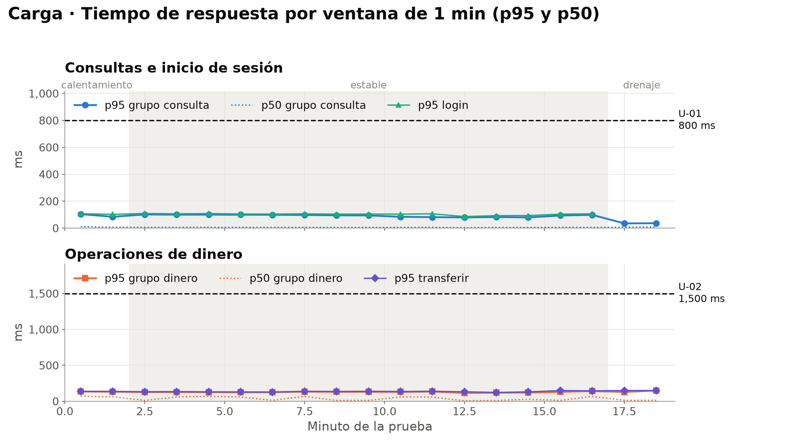
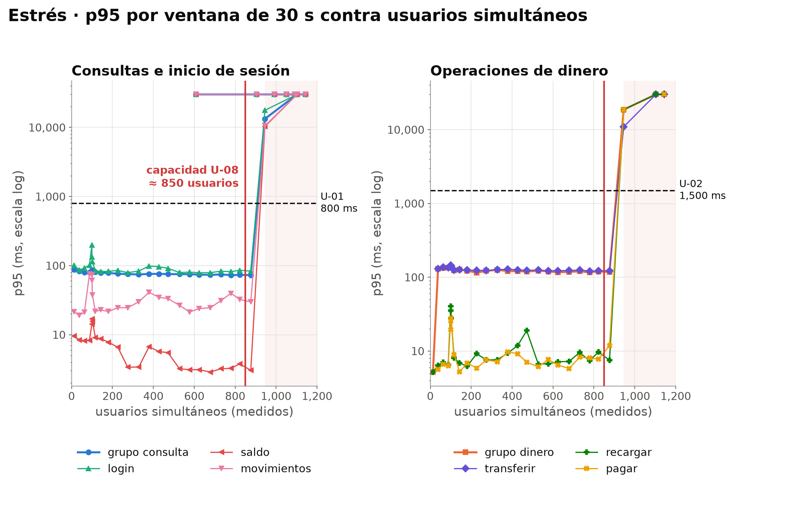
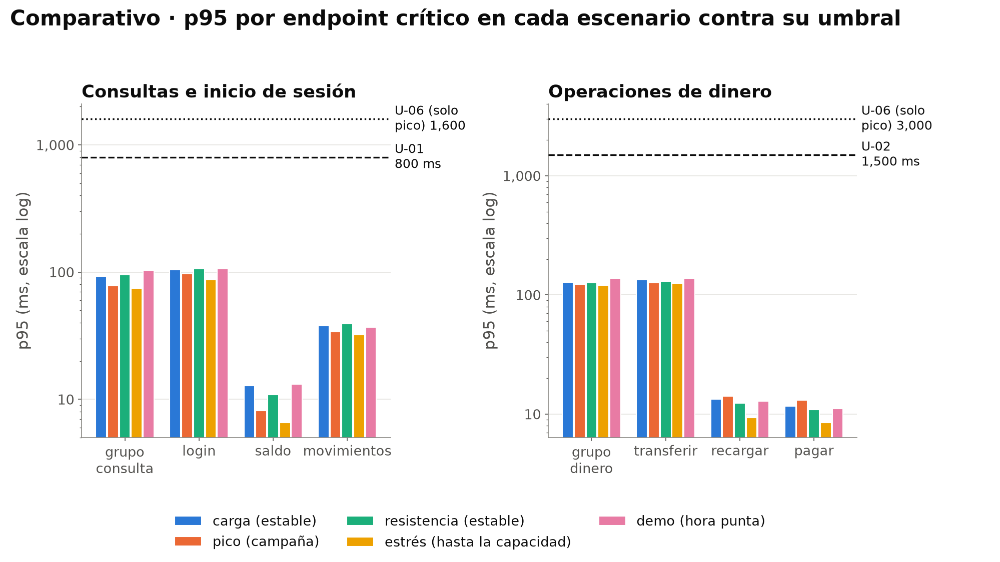

# Informe del proyecto – Johar Barzola

## Los 9 puntos de la entrega final

El anuncio de Canvas del 15-nov-2026 pide nueve puntos. Cada fila dice a qué observación de la Entrega 2 o frase del anuncio responde (el texto literal está en [`respuesta-feedback.md`](respuesta-feedback.md)), qué se hizo, dónde verificarlo y qué se abre en la exposición. Las cifras son del [run #24](https://github.com/Joharjbe/qolqe-wallet/actions/runs/44225240314) (push a `main`, commit `1025a78`, fusión del PR #9, los 8 jobs en verde), salvo donde se nombra otra corrida. La entrega es el tag `entrega-final-v1` ([Release](https://github.com/Joharjbe/qolqe-wallet/releases/tag/entrega-final-v1)). El sitio publicado: https://joharjbe.github.io/qolqe-wallet/.

| # | Punto | Responde a | Qué se hizo | Dónde está la evidencia | Qué se muestra en vivo |
|---|---|---|---|---|---|
| 1 | Arquitectura y herramientas | Obs. 1c y 5 de la Entrega 2 (crítica repetida) | Cuatro herramientas, una pregunta cada una: pytest-bdd (¿se cumple la regla?), Schemathesis (¿la API cumple su contrato?), Playwright con playwright-bdd (¿se puede hacer en la pantalla?) y k6 (¿aguanta la carga?). GitHub Actions las encadena. Cada una se comparó con sus alternativas | §1 · [`arquitectura.md`](arquitectura.md) §1 y §2 · k6 frente a JMeter, Gatling, Locust, Artillery y Taurus: [informe de rendimiento](Informe_Rendimiento_Qolqe.pdf), §2 | Las láminas `arquitectura` (capas) y `herramientas` (tabla de herramientas y alternativas) |
| 2 | Cobertura de API | Obs. 1b de la Entrega 2 y la nota de la Entrega 1 (madurez de la API) | Los 51 criterios tienen al menos un caso de API: 198 funcionales, 78 técnicos y el contrato CP-T04 (19 operaciones). En el run #24: 766 ejecuciones, 707 pasan y 59 son fallo esperado con su `DEF`; el contrato generó 1316 casos y pasaron todos | §2 · [`alcance-y-casos.md`](alcance-y-casos.md) · matriz del run: [`trazabilidad.md`](trazabilidad.md) · jobs [`api`](https://github.com/Joharjbe/qolqe-wallet/actions/runs/44225240314/job/134537294428) y [`contrato`](https://github.com/Joharjbe/qolqe-wallet/actions/runs/44225240314/job/134537055333) | El reporte [`api/`](https://joharjbe.github.io/qolqe-wallet/api/) de Pages, con las peticiones y respuestas de los casos en fallo esperado. Si se pide una ejecución en vivo, con Qolqe levantado por `preparar-demo.sh`: `python -m pytest tests/api -k cpa28 -v` (CP-A28, el caso que el PR #10 rompe a propósito; 1 de las 766 pruebas) |
| 3 | Cobertura web en Gherkin | Obs. 1a de la Entrega 2 (los escenarios que faltaban y el módulo común) | 58 escenarios en 4 `.feature` (27 del núcleo y 31 de G4), que son 71 pruebas por los esquemas. No hay pruebas web fuera del Gherkin: Playwright las genera de `features/web/`. Cada prueba corre 3 veces seguidas: 213 ejecuciones y 0 inestables | §3 · [`features/web/`](../features/web/) · job [`web`](https://github.com/Joharjbe/qolqe-wallet/actions/runs/44225240314/job/134539963107) | El reporte [`web/`](https://joharjbe.github.io/qolqe-wallet/web/) de Pages y `solicitudes_web.feature` |
| 4 | Patrón de diseño | Obs. 4 de la Entrega 2 y lab S11 (crítica repetida); el anuncio suma la escalabilidad | Page Object con componentes y fixtures, comparado con Page Factory, Page Object encadenado, Screenplay, App Actions y Robot Framework con los criterios de la clase 11. Un cambio en un diálogo compartido se corrige en `componentes.ts` y no en cada pantalla. La regla central, ningún localizador en los pasos, la hace cumplir el pipeline. Escalabilidad: un módulo como G5 suma un `.feature`, un archivo de pasos y sus Page Objects; una pantalla, un Page Object y tres líneas en `fixtures.ts`; un integrante, sus propios archivos. Ninguno toca los componentes. El techo real no es el patrón: es `workers: 1`, porque todas las pruebas comparten una base | §3 · [`arquitectura.md`](arquitectura.md) §3 y §3.5 (escalabilidad) · paso «Regla del patrón» del job [`estatico`](https://github.com/Joharjbe/qolqe-wallet/actions/runs/44225240314/job/134536701875) | El recorrido de CP-W10: `solicitudes_web.feature` → `solicitudes.steps.ts` → `SolicitudesPage` → `DialogoConfirmacion` |
| 5 | Pipeline | Obs. 2a de la Entrega 2; el anuncio suma el contrato al inicio y los quality gates claros | 8 jobs, de lo barato a lo caro. El contrato va al inicio: `api` espera a `contrato`, y cada etapa de prueba empieza con una guarda para que una etapa omitida no cuente como aprobada. `quality-gate` da un solo veredicto y escribe en el resumen sus 4 criterios de salida y lo que no evalúa. Al 18-nov-2026, `main` exige `api` y `web`: con las guardas, una etapa en rojo deja a `web` en rojo; `quality-gate` no es check obligatorio | §3 · [`pipeline.md`](pipeline.md) · [`pruebas.yml`](../.github/workflows/pruebas.yml) · job [`quality-gate`](https://github.com/Joharjbe/qolqe-wallet/actions/runs/44225240314/job/134541558872) · el gate en rojo: [PR #10](https://github.com/Joharjbe/qolqe-wallet/pull/10) | El run #24 en Actions: el grafo `estatico` → `contrato` → `api` → `web` → `quality-gate` y el resumen del gate |
| 6 | Reportería | Obs. 2b de la Entrega 2 y lab S11 (opciones de reportería) | `publicar` es el último job: espera a `reportes` y a `gestion-casos`, despliega Pages y deja los enlaces en el resumen del run. *Run workflow* tiene la entrada `evidencia`: con `con-imagenes`, captura, video y traza de cada prueba web y peticiones de cada caso de API; con `sin-imagenes`, solo de los fallos. Las opciones de reportería de cada herramienta, y cuáles se usan, están en [`pipeline.md`](pipeline.md#opciones-de-reportería-de-cada-herramienta) | §3 · job [`publicar`](https://github.com/Joharjbe/qolqe-wallet/actions/runs/44225240314/job/134541770293) · run #18 con `con-imagenes` ([run 43109117336](https://github.com/Joharjbe/qolqe-wallet/actions/runs/43109117336); su sitio y sus reportes web se retuvieron 7 días, hasta el 18-nov-2026; las capturas por caso siguen en su artefacto `trazabilidad` hasta el 09-feb-2027 y hay una copia local del sitio completo) · [sitio publicado](https://joharjbe.github.io/qolqe-wallet/) | Pages: portada, `web/`, `api/`, `evidencias/` y `rendimiento/`; en Actions, *Run workflow* con el desplegable `evidencia`. Sin red: la copia local del sitio del run #18, con imágenes |
| 7 | Trazabilidad y gestión de casos | Obs. 3 de la Entrega 2, que el anuncio repite: «se valorará la investigación» | Cada run genera la matriz HU → CA → CP → resultado → DEF desde las etiquetas y los JUnit, más `junit-cp.xml` y `run.json`. Pages guarda en `historial.json` hasta los últimos 30 runs y `historial.html` dibuja los últimos 15. Kiwi TCMS 17.0 se eligió frente a ocho alternativas (Qase, TestRail, Xray, Zephyr, QMetry, Testmo, Allure TestOps y TestLink); `scripts/kiwi_sincronizar.py` importa cada run de `main` como un TestRun (modo *pull*). En simulación con el run #18: 335 casos, 40 enlaces de defecto y 219 capturas; importado de verdad el 17-nov-2026: 10 TestRuns, y el del #18 con 216 de esas capturas (Kiwi rechazó 3) | §3 · [`gestion-casos.md`](gestion-casos.md) · [`trazabilidad.md`](trazabilidad.md) · artefacto `trazabilidad` de cada run · [`historial.html`](https://joharjbe.github.io/qolqe-wallet/historial.html) · capturas de Kiwi: [`kiwi-testruns.png`](img/kiwi-testruns.png), [`kiwi-testrun-18.png`](img/kiwi-testrun-18.png), [`kiwi-caso-ejecuciones.png`](img/kiwi-caso-ejecuciones.png) y [`kiwi-status-matrix.png`](img/kiwi-status-matrix.png) | `historial.html` en Pages y Kiwi TCMS en https://localhost:8443: la lista de TestRuns y un caso con sus ejecuciones. *Telemetry → Testing → Matrix*, solo si se pide en las preguntas |
| 8 | Capacidad de IA | Punto nuevo del anuncio: «Expliquen qué aporta y cómo validaron su resultado» | Diagnóstico de los fallos de un run: enfoque A de la clase 15 (IA para probar), en la fase de Reporte. No es un job del workflow: se corre a mano sobre los artefactos del run. El código agrupa los fallos y el modelo propone la clase y el `DEF-xx`; cuatro guardas validan cada respuesta. **Aporta, medido:** el código convierte los 40 fallos esperados de la corrida de cierre (§7) en 32 grupos, 32 preguntas en vez de 40 (20 % menos de lectura; el tiempo no se midió), y por cada grupo el modelo propone clase, razón y evidencia; en el eval separa bien los errores de entorno (8 de 8; las reglas, 7 de 8) y lo inestable (4 de 4, como las reglas). Los grupos los arma el código; la clase la propone el modelo y la decide el tester. Se validó con un eval de 52 casos (el «conjunto de oro») y una línea base sin IA. **No aporta:** el modelo no mejora a las reglas en `defecto_real` y no propuso ningún `DEF-xx` en los 52 casos | §7 · [`capacidad-ia.md`](capacidad-ia.md) · [`resultados-capacidad-ia/`](resultados-capacidad-ia/) · [`herramientas/diagnostico_ia/`](../herramientas/diagnostico_ia/README.md) · arnés `tests/diagnostico/` | Las láminas de `ia-que` a `ia-inyeccion`. El reporte del componente sin red, con la línea base (`--modelo lineabase`) o con las respuestas grabadas del 17-nov (`--modelo grabado`), queda para las preguntas ([`guion-capacidad-ia.md`](exposicion/guion-capacidad-ia.md)) |
| 9 | Exposición y demo | Obs. 6 de la Entrega 2 (inseguridad en partes de la exposición) | Deck con notas de orador: abre con el foco de la Parte 3 (cómo se identificaron los tipos, el análisis, los umbrales, las dos pruebas ejecutadas y su veredicto contra los umbrales), sigue con el consolidado punto por punto y termina con el cierre. `scripts/preparar-demo.sh` deja Qolqe levantado con datos limpios y abre las pestañas de la demo. La demo de k6 dura ≈ 2.5 min, con el dashboard en vivo. Entrega individual | [`exposicion/deck/project/`](exposicion/deck/project/) · [`preparar-demo.sh`](../scripts/preparar-demo.sh) · [`tests/performance/README.md`](../tests/performance/README.md), «Demo en vivo» | El deck y la demo de k6, con el dashboard en http://localhost:5665 |

## 1. Datos generales y alcance

| Campo | Valor |
|---|---|
| Integrantes | Johar Jared Barzola Estrella |
| Módulos | Núcleo común (HU-N-01 a HU-N-09) y G4 · Contactos y solicitudes de dinero (HU-G4-01 a HU-G4-10) |
| Herramienta de API | pytest 8.4.2 + httpx + pytest-bdd 9.0.0; Schemathesis 4.32.7 para el contrato |
| Herramienta web | Playwright 1.64.1 (TypeScript) + playwright-bdd 9.2.1, con Page Object, componentes y fixtures |
| CI/CD | GitHub Actions (`.github/workflows/pruebas.yml`), 8 jobs y quality gate |
| Gestión de casos | Kiwi TCMS 17.0 (Docker local) más matriz e historial de ejecuciones en GitHub Pages |
| Herramienta de rendimiento | k6 2.3.0, con Qolqe en Docker (1 CPU y 1 GB); recursos con psutil y `docker stats`, perfiles con py-spy |
| Capacidad de IA | Diagnóstico de los fallos de un run en la fase de reporte, sin dependencias nuevas (biblioteca estándar), con línea base sin IA y guardas; verificado con un eval de 52 casos (el «conjunto de oro»): §7 y [`capacidad-ia.md`](capacidad-ia.md) |

**Alcance y nivel de prueba.** Son 19 historias y sus 51 criterios: 33 del núcleo y 18 de G4. Hay 335 casos: 334 escenarios Gherkin y el caso de contrato CP-T04.

Cada regla se prueba en el nivel más bajo donde se pueda detectar (clase 11). Por la interfaz van solo tres cosas:
- los recorridos críticos;
- lo que solo se ve en la pantalla;
- que un error de la API llegue al usuario.

Por eso la API tiene casi 5 veces más escenarios que la web.

| Módulo | API funcional | API técnico | Web | Contrato | Total |
|---|---:|---:|---:|---:|---:|
| Núcleo | 101 | 53 | 27 | — | 181 |
| G4 | 97 | 25 | 31 | — | 153 |
| Núcleo y G4 | — | — | — | 1 (CP-T04, 19 operaciones) | 1 |
| **Total** | **198** | **78** | **58** | **1** | **335** |

Todos los criterios tienen al menos un caso de API. Los 18 criterios de G4 y 30 de los 33 del núcleo tienen además un caso web. Los otros 3 no se ven en la pantalla: dos SMS y la concurrencia.

El detalle criterio por criterio, la técnica de cada grupo de casos y los casos técnicos están en [`alcance-y-casos.md`](alcance-y-casos.md). La respuesta punto por punto a la retroalimentación está en [`respuesta-feedback.md`](respuesta-feedback.md).

## 2. Pruebas de API

**Herramienta.** pytest-bdd ejecuta escenarios Gherkin con solicitudes HTTP reales (httpx) contra Qolqe levantado. Schemathesis genera casos desde `/openapi.json`. Las dos se complementan: una prueba las reglas de negocio que dice el criterio y la otra, lo que el contrato promete ante entradas que nadie escribió. La comparación con Postman/Newman, Bruno, REST Assured, Karate, Robot Framework, el cliente HTTP de Playwright, Dredd y Pact está en [`arquitectura.md`](arquitectura.md), sección 2.

| Enfoque | Ventajas | Limitaciones | Capacidades de IA |
|---|---|---|---|
| pytest-bdd: casos escritos a partir de los criterios | Gherkin legible y compartido con la web, etiquetas para la trazabilidad, `xfail` estricto ligado a cada `@DEF`, esquemas con ejemplos, JUnit XML | Requiere programar los pasos; pytest-bdd 9 no es compatible con pytest 9 (se fijó pytest 8.4.2) | No las trae; con un asistente externo se generan pasos, que hay que revisar contra los requisitos. La capacidad de IA del proyecto trabaja sobre su salida: lee el JUnit y propone por qué falló cada caso (§7) |
| Schemathesis: casos generados desde el contrato | Cientos de solicitudes sin escribirlas, en 4 fases (ejemplos, cobertura, fuzzing y secuencias con estado); encontró DEF-05, DEF-06, DEF-08 y DEF-29 | No conoce las reglas de negocio; genera falsos positivos que hay que clasificar; el número de casos cambia entre corridas por la fase con estado | No las trae: genera por propiedades, sin IA. Sus fallos entran al mismo diagnóstico de §7 |

**Arquitectura de la capa API.** Detalle y diagrama en [`arquitectura.md`](arquitectura.md), sección 1.

- **Escenarios.** `features/*.feature`: 7 archivos del núcleo y 3 de G4.
- **Enlace.** `tests/api/test_*.py`, que solo llaman a `scenarios()`.
- **Pasos por área.**
  - `conftest.py`: cliente, sesiones por usuario y pasos comunes.
  - `pasos_nucleo_acceso.py`, `pasos_nucleo_dinero.py` y `pasos_g4_extra.py`.
- **Fixture `s`.** Reinicia los datos semilla y el reloj antes de cada escenario (FIRST, *Independent*).
- **Defectos conocidos.** El hook `pytest_bdd_apply_tag` convierte cada `@DEF-xx` en `xfail(strict=True, raises=AssertionError)`: si el defecto se corrige, la prueba da XPASS y el pipeline obliga a retirar la etiqueta; si falla por otra causa (servidor caído, paso roto), queda como fallo y no como el defecto.
- **Evidencia.** El plugin `tests/api/evidencia.py` agrega al reporte HTML las peticiones y respuestas de cada caso, con el token enmascarado.

**Casos funcionales y técnicos.** Cada operación se prueba en las siete dimensiones de la clase 10 (detalle en [`alcance-y-casos.md`](alcance-y-casos.md#casos-técnicos), «Casos técnicos»): **estado** (el código de cada rechazo), **cuerpo** (el formato de error que nombra el campo), **contrato** (CP-T04 y CP-T21), **cabeceras** (CP-NA159, NA160, T11 y T29), **efecto** (saldo, SMS y movimientos), **sin efecto** (un rechazo deja todo igual) y **seguridad** (autenticación, revocación, aislamiento con 404 para un recurso ajeno y fuga de datos).
- **Funcionales.** Cubren cada criterio con valores límite, particiones, transiciones de estado y tablas de decisión. Revisan el código de error y que un rechazo no deje efectos: saldo, SMS y movimientos.
- **Técnicos.** Son 78, más CP-T04. Verifican:
  - autenticación y revocación del token;
  - aislamiento entre usuarios (404 para un recurso ajeno);
  - datos que no deben salir: CCI y DNI completos, y si un celular existe (mismo estado, cuerpo y cabeceras en el ingreso);
  - tipos y forma del cuerpo, y las cabeceras `Content-Type` y `Accept`;
  - asignación masiva;
  - identificadores en el borde;
  - semántica HTTP (405 y `Allow`);
  - esquema de cada respuesta;
  - concurrencia: 10 escenarios con `threading.Barrier` y la etiqueta `@concurrencia`.

**Contrato ampliado.** `scripts/correr-contrato.sh` pasó de 9 operaciones de G4 a 19.
- **Operaciones.** Se sumaron registro, ingreso y salida, sesiones, cuenta, saldo, cierre, transferencias y simulación de comisión.
- **Token por operación.** `scripts/contrato_hooks.py` lo pone y usa un usuario desechable para el logout y el cierre.
- **Exclusiones.** Las exclusiones, los falsos positivos y su motivo están en `schemathesis.toml` y en [`pipeline.md`](pipeline.md).

**Cómo ejecutar.** README, sección 6.

**Resultados y evidencia** ([run #24](https://github.com/Joharjbe/qolqe-wallet/actions/runs/44225240314) del pipeline: push a `main`, commit `1025a78`, fusión del PR #9, los 8 jobs en verde):

| Suite | Escenarios | Ejecuciones | Pasan | Fallo esperado (DEF) | Tiempo en el runner (intento 1) |
|---|---:|---:|---:|---:|---:|
| API núcleo | 154 | 404 | 370 | 34 | — |
| API G4 | 122 | 362 | 337 | 25 | — |
| **API total** | **276** | **766** | **707** | **59** | 386 s |
| Contrato (CP-T04) | 19 operaciones | 1316 casos generados | 1316 | 0 | 13 s |

- **API.** 707 passed y 59 xfailed, sin XPASS ni fallos. Los 59 xfail fallan por una aserción (`raises=AssertionError`). Es el mismo resultado de las 4 corridas locales del 11-nov-2026 (3 de la revisión final y la de verificación), idénticas test por test. En la laptop, la suite tarda 194 s.
- **Concurrencia.** Los 10 escenarios con hilos dieron el mismo resultado en 200 de 200 corridas locales con `--runxfail`: los 9 con DEF reprodujeron su defecto siempre y CP-NA131 pasó siempre. CP-T20 repite su ráfaga hasta 5 veces porque, con una sola, el servidor a veces serializa las altas (regla en [`defectos.md`](defectos.md)).
- **Contrato.** Las 4 fases pasaron en verde. Hubo 28 casos omitidos y 5 descartados por `filter_failure`. Ese filtro solo descarta dos hallazgos ya clasificados: DEF-29 y el falso positivo de `correo: ""`.
  - El número de casos cambia entre corridas con el mismo veredicto, porque la fase con estado depende de las respuestas: 1316 en el run #24, 1373 en la corrida local del 11-nov-2026 y 1291, 1376 y 1414 en otras.
- **Evidencia en GitHub.** Los reportes de API, contrato y web quedan como artefactos de cada run. Pages publica los del último run de `main`: https://joharjbe.github.io/qolqe-wallet/.

## 3. Pruebas web y CI/CD

**Herramienta y patrón.** Playwright Test con playwright-bdd ejecuta los `.feature` de `features/web/`: 2 del núcleo y 2 de G4. El patrón es **Page Object con componentes y fixtures**:

- **Pasos** (`tests/e2e/steps/`, uno por área). Solo traducen el Gherkin: no tienen localizadores. El job `estatico` lo comprueba en cada run con `grep -rnE "getBy|locator\(|page\." tests/e2e/steps` y falla si encuentra uno.
- **Page Objects** (`tests/e2e/pages/`). Login, Registro, Inicio, Perfil, Transferir, Contactos y Solicitudes. Las cinco pantallas con menú heredan de `PaginaQolqe`, una base de un solo nivel. Las pantallas no heredan entre sí.
- **Componentes** (`componentes.ts`). `Aviso`, `DialogoConfirmacion`, `DialogoFormulario`, `ListaVacia` y `Navegacion`, uno por cada componente que `app.js` genera igual en todas las pantallas. Así un cambio en un diálogo se corrige en un solo lugar.
  - Tres los componen las pantallas como campos: `DialogoFormulario` (Contactos, Solicitudes y Perfil), `DialogoConfirmacion` (Contactos y Solicitudes) y `Navegacion` (por `PaginaQolqe`).
  - `Aviso` y `ListaVacia` no los compone ninguna pantalla: `fixtures.ts` los crea y los entrega a dos pasos comunes («ve el aviso…» y «ve el mensaje vacío…», en `comunes.steps.ts`). Un paso común no sabe en qué pantalla está, así que el componente le llega por la fixture y no por una pantalla.
- **Fixtures** (`tests/e2e/fixtures.ts`). Entregan las páginas. `DatosPrueba` reinicia datos y reloj y prepara el estado por la API de soporte, no por la pantalla; si el reinicio falla, el escenario no corre.
- **Localizadores.**
  - Se localiza por `data-testid`, el contrato estable que expone Qolqe. Las `option` de un selector no lo tienen en `app.js`: se buscan con `locator('option')` dentro del selector, que sí lo tiene.
  - El rol, el texto y los atributos de accesibilidad (`aria-pressed`, `aria-selected`) se usan cuando lo que se verifica es lo que se ve.
  - La posición se usa cuando lo que se verifica es el orden, y para esperar a que una lista termine de cargar: `.nth(1)` en `TransferirPage.abrir` y `.first()` en `SolicitudesPage.abrir` e `irAPestana`. No hay clases de estilo.
  - Hay un solo worker porque todas las pruebas comparten una base.
- **Escalabilidad** ([`arquitectura.md`](arquitectura.md) §3.5). Un módulo, una pantalla o un integrante nuevos suman sus propios archivos y reutilizan los componentes tal cual. El techo no es el patrón: es el worker único, porque todas las pruebas comparten una base, y cada prueba que se suma alarga el run.

La comparación con Page Factory, Page Object encadenado, Screenplay, App Actions y Robot Framework está en [`arquitectura.md`](arquitectura.md), sección 3, con los criterios de la clase 11 (tamaño, cambios de interfaz, BDD y lo que trae el framework). Frente a Robot Framework, la diferencia no es la espera automática: la librería Browser también corre sobre Playwright. Las diferencias son tres:
- los mismos `.feature`, con las mismas etiquetas que la API;
- el runner de Playwright, con `repeatEach`, reintentos que marcan una prueba como inestable, `failOnFlakyTests`, `webServer` y el reporte con trazas;
- la evidencia de que esa combinación sirve: en el run #13 detectó un escenario inestable real y puso el pipeline en rojo.

**Capacidades de IA de las herramientas.** El pipeline no llama a un modelo: la capacidad de IA del proyecto (§7) se corre aparte, sobre los artefactos que el pipeline publica, para que no pueda cambiar el veredicto del gate. Lo que traen las herramientas de esta sección no se usa:

| Herramienta | Capacidades de IA | Por qué no se usan |
|---|---|---|
| Playwright 1.64.1 | Un servidor MCP y tres agentes para el repositorio: uno planifica pruebas, otro las genera y otro repara las que fallan (`npx playwright --help`, comandos `mcp` e `init-agents`; los agentes vienen en `node_modules/playwright/lib/agents/`) | Reparar localizadores no tiene qué reparar: la web corre 3 veces seguidas con 0 inestables. Generar casos subiría el número de pruebas sin subir lo que se cubre, porque cada escenario ya sale de un criterio con su técnica: es la falsa cobertura de la clase 15 ([`capacidad-ia.md`](capacidad-ia.md), «Alternativas descartadas») |
| playwright-bdd 9.2.1 | Ninguna | — |
| GitHub Actions | Con Copilot, *Explain error* en un check fallido abre un chat que explica el fallo ([Troubleshooting workflows](https://docs.github.com/en/actions/how-tos/troubleshoot-workflows)) | Explica un check a la vez, en un chat: no deja una salida que se pueda medir contra el conjunto de oro, como se midió la capacidad de §7 |
| Kiwi TCMS 17.0 | No llama a ningún modelo: su entorno no tiene paquetes de IA (`pip list` en el contenedor `qolqe_kiwi_web`). Publica la descripción de su API JSON-RPC para agentes en `/static/api/llms.txt`, que genera el comando `generate_rpc_schema` | La sincronización no necesita un agente: la hace `scripts/kiwi_sincronizar.py` con el cliente `tcms-api` |

**Etapas del pipeline** (`.github/workflows/pruebas.yml`). Corre en cada push a `main`, en cada PR a `main` y a pedido. El detalle y la justificación de cada job están en [`pipeline.md`](pipeline.md).

| Job | Depende de | Qué hace | Por qué |
|---|---|---|---|
| `estatico` | — | ruff, `tsc --noEmit`, `bddgen`, `pytest --collect-only`, `trazabilidad.py --verificar`, actionlint y la regla del patrón | *Fail fast*: en un minuto y sin servidor detecta un paso sin definir, un error de tipos, una etiqueta `@CP` faltante, un workflow mal escrito o un localizador en un paso |
| `contrato` | `estatico` | Schemathesis, 19 operaciones | Primera prueba dinámica, **al inicio**: si la API no cumple el contrato que promete, los casos diseñados prueban sobre una base que no se sostiene. Otro runner y otra base. En la Entrega 2 iba dentro de `api` y se perdía si fallaba pytest; en la primera versión del pipeline final (PR #7) corría en paralelo con `api`; desde el PR #9 va antes y la bloquea |
| `api` | `estatico` y `contrato` | pytest-bdd del núcleo y de G4, funcional y técnico | Con el contrato cumplido, los casos diseñados. Check obligatorio |
| `web` | `api` y `contrato` | Playwright, 3 repeticiones | La etapa más cara solo corre con la API en verde. Check obligatorio |
| `quality-gate` | las 4 anteriores, `always()` | Pasa solo si las 4 terminan en `success` | Un solo veredicto en el resumen; un job omitido no cuenta como aprobado. No es check obligatorio (al 18-nov-2026): el merge lo bloquean `api` y `web` |
| `reportes` | las 4 etapas; corre si `estatico` está en verde | Matriz, `junit-cp.xml`, `run.json`, evidencias por CP y la Parte 3 en el sitio | Corre aunque fallen las pruebas: el reporte explica el fallo |
| `gestion-casos` | `reportes`, solo `main` | Registra el run en Kiwi TCMS | Preparado para un Kiwi accesible desde internet. Hoy termina con un aviso y la sincronización es local (pull) |
| `publicar` | `reportes` y `gestion-casos`, solo `main` | GitHub Pages con portada, reportes, rendimiento, evidencias por caso e historial (hasta 30 runs en `historial.json`; los últimos 15 en `historial.html`) | Último job del run: el reporte queda visible al terminar y el resumen trae sus enlaces. Único job con `pages: write` (mínimo privilegio). Despliegues en serie |

**Evidencia con o sin imágenes.** *Run workflow* tiene la entrada `evidencia`. Push y PR usan `sin-imagenes`.

| | `sin-imagenes` | `con-imagenes` |
|---|---|---|
| Web | Captura y traza de los fallos, video en el reintento | Captura, video y traza de cada prueba |
| API | Peticiones y respuestas de los fallos y de los xfail | Peticiones y respuestas de cada caso |
| Contrato | JUnit y HTML | Además `peticiones.har` |
| Retención | 14 días | 7 días |

La variable `EVIDENCIA` la leen `playwright.config.ts`, `tests/api/evidencia.py` y `scripts/correr-contrato.sh`. Las mismas opciones existen en local con `npm run test:web:con-imagenes` y `npm run test:api:con-imagenes`.

**Quality gate.** El criterio de salida es que todas las pruebas pasen. Los fallos conocidos deben ser xfail estrictos con su DEF en [`defectos.md`](defectos.md) y no puede haber pruebas inestables (`failOnFlakyTests`). El job `quality-gate` lo evalúa en cada run y escribe en el resumen sus 4 criterios de salida, el job que hace cumplir cada uno y lo que no evalúa: el rendimiento y el job `reportes`.

En la protección de `main`, `api` y `web` son status checks obligatorios, con `enforce_admins` activo (al 18-nov-2026). GitHub cuenta como aprobado un job omitido. Por eso `contrato`, `api` y `web` empiezan con una guarda: si la etapa anterior no terminó en `success`, fallan en segundos y no quedan como omitidos, así que una etapa en rojo deja a `web` en rojo. `quality-gate` corre siempre (`always()`), trata `skipped` como no aprobado y da el veredicto único en el resumen, pero no está marcado como obligatorio. El [PR #10](https://github.com/Joharjbe/qolqe-wallet/pull/10) lo muestra con el pipeline actual. Rompe a propósito el saldo esperado de CP-A28 y no se fusiona. En su [run #25](https://github.com/Joharjbe/qolqe-wallet/actions/runs/44240958431) (commit `100674c`), `estatico` y `contrato` pasan y `api` falla: 1 failed, 706 passed y 59 xfailed, porque CP-A28 espera 770.00 y el saldo es 775.00. `web` falla en su guarda, sin omitirse, y `quality-gate` da «no pasa» ([captura del run #25](img/demo-gate-rojo.png)). `reportes` corre igual; `gestion-casos` y `publicar` se saltan por ser un PR. La fusión queda bloqueada: `gh pr view 10` da `BLOCKED` (18-nov-2026).

**Trazabilidad HU → casos → ejecución, a lo largo de muchas ejecuciones.**

- **Modelo.** `.github/scripts/trazabilidad.py`, con el modelo en `casos.py`, une las etiquetas `@HU`, `@CA`, `@CP`, `@DEF` y `@tecnico` con los JUnit de las tres herramientas.
- **Salidas de cada run:**
  - la matriz agrupada por módulo, nivel y tipo;
  - `junit-cp.xml`, un caso por CP con sus propiedades;
  - `run.json`, con el commit, el evento, la evidencia y el estado de cada CP;
  - las evidencias por CP.
- **Historial.** `publicar` suma cada run a `historial.json` y publica `historial.html` en Pages. Es una grilla CP × runs con los últimos 15 runs; los conteos, la estabilidad y la primera y última vez salen de todos los que guarda `historial.json` (hasta 30).
- **Kiwi TCMS 17.0.** Es la herramienta de gestión de casos elegida: gratis, sin límite de runs y con importador JUnit oficial. Corre en Docker local.
  - `scripts/kiwi_sincronizar.py` importa cada run de GitHub como un TestRun, también los runs anteriores reconstruidos desde sus artefactos.
  - Cada CP acumula ahí todas sus ejecuciones.
- **Investigación y estado.** La comparación con ocho alternativas (Qase, TestRail, Xray, Zephyr, QMetry, Testmo, Allure TestOps y TestLink), la integración y el estado verificado están en [`gestion-casos.md`](gestion-casos.md).
- **Verificación.** `trazabilidad.py --verificar` corre en `estatico` y falla si a un escenario le falta `@HU` o `@CP`, si un CP se repite o si un par `@HU` `@CA` no existe en `requisitos.md`.

**Resultados** (run #24, el mismo de la sección 2):
- **Web.** 58 escenarios, que son 71 pruebas; con 3 repeticiones, 213 ejecuciones en 3.4 minutos en el runner (intento 1; 2.5 minutos en la laptop). Pasan 210, hay 3 fallos esperados (CP-NW03, DEF-18) y 0 inestables (reintento y `failOnFlakyTests`).
- **Trazabilidad.** La matriz del run ([`trazabilidad.md`](trazabilidad.md), tomada del artefacto `trazabilidad`): 335 casos, 295 passed y 40 xfailed, sin casos sin ejecutar. Hay 25 defectos enlazados a sus casos.
- **Etapa estática.** `ruff`, `tsc`, `bddgen`, `--collect-only`, `--verificar`, `actionlint` y la regla del patrón terminan sin errores.

El workflow corre en GitHub en verde desde el PR #7: los 9 runs del #16 ([run 43104812888](https://github.com/Joharjbe/qolqe-wallet/actions/runs/43104812888)) al #24 terminaron en `success`; el siguiente, el #25 del PR #10, está en rojo a propósito (*Quality gate*, arriba). En un PR, `gestion-casos` y `publicar` se saltan porque solo corren en `main`. En `main`, `publicar` actualiza GitHub Pages y `gestion-casos` termina con un aviso sin registrar el run en Kiwi, porque el repositorio no tiene los secretos `KIWI_URL`, `KIWI_USUARIO` y `KIWI_CLAVE`. Kiwi corre en la máquina del alumno y el runner no llega a él: la sincronización es *pull* desde esa máquina ([`gestion-casos.md`](gestion-casos.md)).

**Evidencia anterior en GitHub (Entrega 2).**
- El [run #10](https://github.com/Joharjbe/qolqe-wallet/actions/runs/41123298780) pasó 57 de 57 ejecuciones web.
- En el run #13, `failOnFlakyTests` puso el pipeline en rojo por CP-W10 inestable. Era un error de la prueba, que no esperaba el alta del contacto, y se corrigió.
- El [PR #3](https://github.com/Joharjbe/qolqe-wallet/pull/3) (rama `demo-quality-gate`) es del pipeline de la Entrega 2, que todavía no tenía el job `quality-gate`: el cambio lo bloquea el check obligatorio `api` en rojo, con `web` y `reportes` omitidos. La misma demo con el pipeline actual es el PR #10 (*Quality gate*, arriba).

**Defectos vistos desde la interfaz.**
- Por la interfaz apareció un defecto propio: DEF-18, el mensaje de validación en inglés.
- DEF-03 no se alcanza por pantalla: la interfaz oculta el botón de aceptar en una solicitud vencida (CP-W15). Sí se alcanza por la API.

## 4. Pruebas de rendimiento

Informe completo con la plantilla del curso: [`Informe_Rendimiento_Qolqe.docx`](Informe_Rendimiento_Qolqe.docx) (copia en [PDF](Informe_Rendimiento_Qolqe.pdf)). Cómo repetir las pruebas: [`tests/performance/README.md`](../tests/performance/README.md). Las corridas son del 11-nov-2026 y su evidencia está en [`tests/performance/resultados/`](../tests/performance/resultados/). La Parte 3 se entregó con el tag `parte-3`, sobre el merge de la rama `parte-3-rendimiento` en `main`.

**Capa objetivo, herramienta y entorno.** La capa objetivo es la API (informe de rendimiento, §1): los umbrales hablan del tiempo en que responde el servidor, y la web llama a los mismos endpoints. k6 2.3.0. El requerimiento expresa la carga como tasa de llegada (3,000 sesiones por hora) y pide sostenerla "sin acumular retrasos": k6 la modela con ejecutores de llegada (modelo abierto), registra las sesiones que no puede iniciar y termina con código 99 si falla algún umbral. La comparación con JMeter, Gatling, Locust, Artillery y Taurus está en el informe, §2. Qolqe corrió en Docker con `--cpus=1 --memory=1g` y k6 en el host (MacBook Pro M1 Pro, 10 núcleos, 16 GB). CPU y memoria se midieron sobre el proceso de Qolqe con psutil y `docker stats` en cada corrida. Los resultados son una **línea base relativa**, no la capacidad de producción.

**Capacidades de IA de la herramienta.** k6 2.3.0 ofrece en `k6 x` tres subcomandos de IA, de extensiones oficiales de Grafana: `mcp`, un servidor MCP para agentes (`grafana/mcp-k6`); `agent`, que prepara un flujo de pruebas asistido por IA en el editor (`grafana/xk6-subcommand-agent`), y `docs`, la documentación de k6 para agentes (`grafana/xk6-docs`). No vienen en el binario: k6 arma uno con la extensión cuando se usan (resolución automática de extensiones). Fuente: `k6 x --help` y `k6 x explore`, que las marca como oficiales. No se usan: el veredicto de cada umbral U-01 a U-09 lo evalúa código (`tests/performance/analisis/veredicto.py`), porque un umbral de latencia es una comparación, no un juicio.

**Escenarios.** Sesión = login + 6 operaciones con pausas de 10 a 25 s (media 18 s) y la mezcla del requerimiento. 3,000 sesiones/h equivalen a 100 usuarios simultáneos (Ley de Little: 0.833 sesiones/s × 120 s). Datos: 3,000 usuarios distintos, uno por VU, con S/ 10,000, 5 contactos, 30 deudas y 1,000 movimientos cada uno. **Del requerimiento a los umbrales:** los flujos críticos son F-01 a F-06 y los umbrales U-01 a U-09, cada uno con métrica, percentil, valor límite y carga ([`diseno-rendimiento.md`](diseno-rendimiento.md) §1 y §2.1). Lo que no se podía convertir tiene su supuesto (§2.2): «sin acumular retrasos» → 0 sesiones descartadas y throughput ≥ 98 % de lo ofrecido (S-04); «degradación razonable» → hasta 2 × el umbral normal (S-05). **Se ejecutaron los cuatro tipos; las dos pruebas más importantes son carga y estrés.** Responden dos de las tres preguntas del negocio, «si cumplimos en hora punta» y «hasta cuántos usuarios simultáneos podemos crecer», y son las que pide la rúbrica de la Parte 3 («Carga y estrés ejecutadas»). Pico y resistencia también se ejecutaron, con su justificación (informe de rendimiento, §3).

| Tipo | Carga | Pregunta del requerimiento | Umbrales que juzga | Corrida |
|---|---|---|---|---|
| Carga | 100 simultáneos, 15 min estables | ¿Cumplimos en hora punta, sin acumular retrasos? | U-01 a U-05 y U-07 | `carga/20261111-1833` |
| Pico | 100 → 300 → 100 (12:00–12:15) | ¿Cumplimos en el pico de la campaña? ¿Queda el dinero íntegro? | U-06 y U-07 | `pico/20261111-1918` |
| Estrés | Rampa de 100 a 2,400 (k6 la cortó a los 947.7 s, 952 s con la preparación del harness, después de un máximo de 1,144 simultáneos) | ¿Hasta cuántos usuarios podemos crecer? | U-08 (con U-01 a U-05 como criterio de capacidad) y U-07 | `estres/20261111-1940` (2 CPU: `escalabilidad/20261111-2103`) |
| Resistencia | 100 simultáneos, 60 min (proyección a 18 h) | ¿Opera de 6:00 a 24:00 sin reinicios? | U-01 a U-05, U-07 y U-09 | `resistencia/20261111-1958` |

**Resultados frente al SLA** (p95 por rango más cercano; carga y resistencia en la fase estable, pico en 12:00–12:15).

| Umbral | Carga | Pico | Estrés | Resistencia |
|---|---|---|---|---|
| U-01 · Consultas y login: p95 < 800 ms (pico: U-06, < 1,600 ms) | 93 ms (login 105) · cumple | 78 ms (login 97) · cumple | criterio de capacidad (U-08) | 95 ms (login 106) · cumple |
| U-02 · Dinero: p95 < 1,500 ms (pico: U-06, < 3,000 ms) | 128 ms (transferir 134) · cumple | 123 ms (transferir 126) · cumple | criterio de capacidad (U-08) | 127 ms (transferir 130) · cumple |
| U-03 · Operaciones fallidas ≤ 1 % (pico: U-06) | 0.00 % · cumple | 0.00 % · cumple | criterio de capacidad (U-08) | 0.00 % · cumple |
| U-04 y U-05 · Throughput ≥ 9.6 req/s y 0 sesiones descartadas | 9.77 req/s; 0 · cumple | no aplica (se evalúan en carga y resistencia); las 0 descartadas cuentan en U-06 · cumple; máx. 30.2 req/s, informativo | criterio de capacidad (U-08) | 9.77 req/s; 0 · cumple |
| U-07 · Dinero sin operaciones a medias ni duplicadas | 0 descuadres · cumple | 0 descuadres · cumple | 0 descuadres · cumple | 0 descuadres · cumple |

En la resistencia, además (U-09, cumple), el RSS proyectado a 54,000 sesiones es 92 MB (límite 700) y el p95 no deriva (0.98 × en consultas, 1.01 × en dinero). El pico vuelve a cumplir los umbrales normales en 12:10–12:15 (80 / 123 ms). En el tramo con ~300 simultáneos (12:02–12:05, seis ventanas de 30 s con 289–304 simultáneos) el peor p95 por ventana fue 84 ms en consultas, 125 ms en dinero y 114 ms en el login, con 0 % de error (`pico/20261111-1918/ventanas.csv`). Si el triple se sostuviera los 15 min (150 sesiones/min, 29.35 req/s ofrecidas), la evidencia más cercana es el estrés: estuvo sobre 300 simultáneos 6 min seguidos (del min 6.0 al 12.0, de 329 a 876 usuarios) con p95 de consultas ≤ 76 ms, dinero ≤ 126 ms, login ≤ 99 ms y 0 % de error (`estres/20261111-1940/ventanas.csv`), lejos de los 1,600 / 3,000 ms de U-06.

**Capacidad (U-08: se mide, no es pasa o falla).** **850 usuarios simultáneos** cumplen todos los criterios de hora punta con 1 CPU (≈ 25,500 sesiones/h): 8.5 veces la hora punta y 2.8 veces el pico de la campaña. Con 2 CPU, 1,300 (× 1.53, no × 2). La hipótesis previa del diseño (≈ 1,500 ± 300 con 1 CPU, informe M-14) queda refutada. El colapso es brusco: entre 876 simultáneos (min 11.8, la última ventana que cumple) y 946 (min 12.2, la primera falla sostenida) el p95 de todas las peticiones pasa de 78 ms a 13.4 s (el de consultas, de 73 ms a 13.3 s) y el throughput cae de 85.2 a 26.1 req/s.

**Gráficos.**

Más gráficos: [throughput en carga](../tests/performance/resultados/carga/20261111-1833/graficos/G2_throughput.png) · [usuarios simultáneos en el pico](../tests/performance/resultados/pico/20261111-1918/graficos/G4_usuarios_simultaneos.png) · [rodilla de throughput](../tests/performance/resultados/estres/20261111-1940/graficos/G7_throughput_vs_usuarios.png) · [errores en estrés](../tests/performance/resultados/estres/20261111-1940/graficos/G3_errores.png) · [memoria en resistencia](../tests/performance/resultados/resistencia/20261111-1958/graficos/G9_memoria_vs_sesiones.png).

**Cuello de botella.** La escritura de la sesión en SQLite durante el login (`autenticacion.py:136`), sobre un login que ya gasta la mayor parte del CPU en el PBKDF2. Evidencia:
- Las respuestas 500 del estrés son `database is locked`: 733 de las 829 excepciones del log vienen de ese INSERT (1,202 de 1,280 con 2 CPU).
- En el colapso con 2 CPU, las 40 plazas del pool de hilos de AnyIO están detenidas en esa línea esperando el bloqueo (`hilos_meseta.txt`).
- Por qué un INSERT de una fila espera los 10 s del `busy_timeout` (leído en el código y coherente con la foto de hilos; no se probó aparte): la transacción implícita del INSERT se confirma recién al cerrar la dependencia `obtener_bd` (`bd.py:216-222`), y en FastAPI 0.117.1 ese cierre corre después de validar la respuesta, que en un endpoint síncrono pide otra plaza del mismo pool de 40 (`fastapi/routing.py:172-177`). Con el pool lleno de logins que esperan el bloqueo, el que lo tiene no consigue plaza y no lo suelta hasta que los demás fallan a los 10 s con `database is locked`. Por eso el colapso es brusco y el CPU de Qolqe baja durante el colapso (75.5 % → 60.0 % → 41.7 %).
- py-spy: `verificar_pin` (PBKDF2) se lleva el 53–63 % de las muestras con 1 CPU (47–63 % según el perfil, contando los de 2 CPU) y la línea 136, el 19.6 % en el colapso con 1 CPU.
- Justo antes del colapso, en la última ventana que cumple, el CPU de Qolqe estaba en 75.5 % (113 % de 200 % con 2 CPU); en la primera ventana que falla bajó a 60.0 % (51.8 %). Y duplicar el CPU no duplica la capacidad.

**Recomendaciones.** Hacer `commit` dentro del endpoint justo después del INSERT de la sesión (y después de `mover_saldo`), para no retener el bloqueo mientras la respuesta espera plaza en el pool, y a más largo plazo guardar la sesión en un almacén aparte o usar una base de datos con varios escritores; fallar rápido (503) en lugar de encolar hasta el timeout de 30 s; renovar tokens para pagar menos veces el PBKDF2; corregir el N+1 de movimientos; agregar una clave de idempotencia a las operaciones de dinero (en el colapso hubo operaciones aplicadas cuyo cliente recibió un timeout), y escalonar los logins de la campaña.

**Limitaciones declaradas.** Laptop compartida con procesos de macOS (en el pico y el estrés el CPU total del equipo pasó del 80 % en algunas ventanas, nunca por k6); el login con 1 VU dio 92 ms frente al límite de 80 ms de la referencia (V-06); V-04 y V-01 se ajustaron durante la ejecución; el estrés lo cortó la red de seguridad técnica de k6 (20 % de operaciones fallidas acumulado desde el inicio, no es un umbral del SLA) antes de la meseta, y la resistencia duró 60 min en lugar de 18 h. Detalle en el informe, §5 y §6.

## 5. Defectos encontrados

Hay 30 defectos abiertos: 8 críticos, 5 altos, 9 medios y 8 bajos. Por módulo:
- 16 son del núcleo;
- 10 son de G4;
- 2 afectan a ambos (DEF-04 y DEF-21);
- 1 afecta a toda la API (DEF-07);
- 1 es de G3 y se halló desde el núcleo (DEF-24).

Por cómo se detectaron:
- 24 con pruebas de API;
- 1 con la web (DEF-18);
- 2 solo con el contrato (DEF-05 y DEF-29);
- 1 en el pipeline (DEF-07);
- 2 con evidencia manual (DEF-16 y DEF-30).

| ID | Título | Módulo | Severidad | Prioridad (propuesta) | Lo detecta | Estado |
|---|---|---|---|---|---|---|
| DEF-01 | El alias rechaza la letra ñ | G4 | Media | Media | CP-A04, A79, A80 | Abierto |
| DEF-02 | El alias duplicado no se detecta si tiene espacios alrededor | G4 | Media | Media | CP-A06, A54 | Abierto |
| DEF-03 | Se puede aceptar una solicitud vencida y se transfiere el dinero | G4 | Crítica | Alta | CP-A32, NA95 | Abierto |
| DEF-04 | Se puede transferir a una cuenta cerrada (contacto, celular o solicitud) | Núcleo y G4 | Crítica | Alta | CP-A18, NA94, NA112 (NA95, junto con DEF-03) | Abierto |
| DEF-05 | El contrato OpenAPI no declara las reglas de los campos | G4 (contrato) | Baja | Baja | CP-T04 (check excluido) | Abierto |
| DEF-06 | `Allow` incompleto en la respuesta a `OPTIONS` | G4 | Baja | Baja | CP-T29 | Abierto |
| DEF-07 | La respuesta puede llegar antes de que los datos queden guardados | Toda la API | Alta | Alta | Primer run del pipeline | Abierto (mitigado en el pipeline) |
| DEF-08 | `favorito` acepta 0 y 1 aunque el contrato pide un booleano | G4 | Baja | Baja | CP-T26 | Abierto |
| DEF-09 | Cerrar sesión no invalida el token | Núcleo | Crítica | Alta | CP-NA44 a NA46, T07 | Abierto |
| DEF-10 | Un ingreso exitoso no reinicia el conteo de intentos fallidos | Núcleo | Media | Alta | CP-NA30 | Abierto |
| DEF-11 | Intentos fallidos simultáneos no bloquean la cuenta | Núcleo | Crítica | Alta | CP-NA33 | Abierto |
| DEF-12 | Se acepta un PIN con secuencia descendente | Núcleo | Alta | Alta | CP-NA15 | Abierto |
| DEF-13 | Nombres con espacios se guardan vacíos o con 1 carácter | Núcleo | Media | Media | CP-NA04 | Abierto |
| DEF-14 | Registros simultáneos del mismo celular responden 500 | Núcleo | Media | Media | CP-NA12 | Abierto |
| DEF-15 | Correo duplicado entre cuentas activas con registros o ediciones simultáneas | Núcleo | Media | Media | CP-NA20 (la edición, CP-NA69, es evidencia manual) | Abierto |
| DEF-16 | El tiempo de respuesta revela si un celular está registrado | Núcleo | Media | Baja | Evidencia manual (CP-NA28) | Abierto (solo evidencia manual) |
| DEF-17 | Un token con `sub` no numérico responde 500 | Núcleo | Baja | Baja | CP-NA60 | Abierto |
| DEF-18 | El registro muestra el mensaje de validación en inglés | Núcleo (web) | Baja | Baja | CP-NW03 (`@fail`) | Abierto |
| DEF-19 | La interbancaria no considera la comisión y el saldo queda negativo | Núcleo | Crítica | Alta | CP-NA144 | Abierto |
| DEF-20 | El límite diario no suma las transferencias interbancarias | Núcleo | Alta | Alta | CP-NA117, NA146 | Abierto |
| DEF-21 | Transferencias simultáneas superan el saldo o el límite diario | Núcleo y G4 | Crítica | Alta | CP-NA134, NA135, T18 | Abierto |
| DEF-22 | El código de operación se repite en el mismo segundo | Núcleo | Alta | Media | CP-NA126, NA127 | Abierto |
| DEF-23 | La comisión usa redondeo bancario en vez del comercial | Núcleo | Media | Media | CP-NA142, NA151 | Abierto |
| DEF-24 | El detalle por código de operación no filtra por usuario | G3 (hallado desde el núcleo) | Alta | Media | CP-NA129, NA130 | Abierto |
| DEF-25 | Aceptaciones simultáneas de la misma solicitud debitan varias veces | G4 | Crítica | Alta | CP-T17 | Abierto |
| DEF-26 | Altas simultáneas del mismo celular crean contactos repetidos | G4 | Media | Media | CP-T20 | Abierto |
| DEF-27 | Los alias que empiezan con tilde se ordenan al final | G4 | Baja | Baja | CP-A47 | Abierto |
| DEF-28 | `contacto_id` acepta un booleano y transfiere al contacto 1 | Núcleo | Baja | Baja | CP-NA104 | Abierto |
| DEF-29 | La transferencia acepta un campo del otro tipo que no cumple su formato | Núcleo (contrato) | Baja | Baja | CP-T04 (`filter_failure`) | Abierto |
| DEF-30 | Cancelar o rechazar a la vez que se acepta responde 200 y el dinero igual se mueve | G4 | Crítica | Alta | Evidencia manual (CP-T19) | Abierto (solo evidencia manual) |

Pasos para reproducir, resultado esperado y obtenido, prioridad y evidencia de cada uno en [`defectos.md`](defectos.md). La severidad la propone el tester; la prioridad también es una propuesta del tester, porque en este proyecto no hay PO: en el curso la define el negocio (clase 7). Del DEF-09 al DEF-29 se volvieron a reproducir contra la app el 11-nov-2026 antes de documentarlos. DEF-30 se midió el 17-nov-2026 con un script, en 400 rondas ([`resultados-manuales/cp-t19.md`](resultados-manuales/cp-t19.md)). DEF-18 y DEF-27 son de usabilidad: `defectos.md` dice en qué se basa cada uno, porque ningún requisito fija el idioma ni la intercalación.

Además hay dos observaciones que no son defectos según los requisitos: OBS-01, el cierre de cuenta permite probar PIN sin límite (CP-NA84), y OBS-02, sin `Content-Type` la API toma el cuerpo como JSON (CP-NA160).

## 6. Conclusiones y recomendaciones

**Estado de calidad.** El núcleo y G4 no están listos para producción.
- De los 335 casos, 295 pasan y 40 fallan por 25 defectos conocidos.
- Los 8 defectos críticos tocan lo más sensible de una billetera.
  - Seis mueven dinero de forma indebida: DEF-03, DEF-04, DEF-19, DEF-21, DEF-25 y DEF-30.
  - Dos debilitan el acceso: DEF-09 (el token sigue sirviendo tras el logout) y DEF-11 (el bloqueo se evita con intentos simultáneos).
- Lo que sí funciona según los criterios:
  - las validaciones de formato y límites;
  - los permisos entre usuarios en G4;
  - la máquina de estados de las solicitudes, salvo aceptar una vencida (DEF-03), las aceptaciones simultáneas (DEF-25) y aceptar a la vez que se cancela o se rechaza (DEF-30);
  - lo que muestra la interfaz.
- Rendimiento (§4): cumple la hora punta y el pico de la campaña con margen (p95 de 93 y 128 ms en hora punta, 0.00 % de error) y el dinero queda íntegro en todas las corridas. El límite está en 850 simultáneos con 1 CPU y el colapso es brusco, por la escritura de la sesión en SQLite durante el login.

**Causas que se repiten** (de la evidencia de [`defectos.md`](defectos.md)):

| Causa | Defectos |
|---|---|
| Leer, validar y escribir sin transacción atómica ni `UPDATE` condicional | DEF-11, DEF-21, DEF-25, DEF-30 |
| Unicidad comprobada con una consulta previa, sin restricción `UNIQUE` | DEF-14, DEF-15, DEF-26 |
| Validación de estado incompleta: aceptar no usa `_exigir_pendiente`; el destino no se revisa | DEF-03, DEF-04 |
| Reglas de dinero mal implementadas: comisión fuera del saldo, límite sin interbancarias, redondeo, código sin secuencia | DEF-19, DEF-20, DEF-22, DEF-23 |
| Revocación del token por el JWT completo en vez del `jti`; conteo de fallos que no se reinicia | DEF-09, DEF-10 |
| Código y contrato desalineados: Pydantic permisivo y esquema sin restricciones | DEF-05, DEF-06, DEF-08, DEF-28, DEF-29 |

**Recomendaciones para el equipo de desarrollo, en orden.**
1. **Operaciones de dinero atómicas.** Usar `BEGIN IMMEDIATE` o `UPDATE … WHERE saldo >= total` y `WHERE estado = 'PENDIENTE'` (en aceptar, rechazar y cancelar: si solo aceptar lo usa, una cancelación que leyó PENDIENTE todavía puede pisar una ACEPTADA). Comparar el saldo con monto más comisión y exigir que el destino esté activo. Corrige DEF-03, 04, 19, 21, 25 y 30.
2. **Sesión.** Revocar por `jti`, marcar `sesiones.cerrada_en` y actualizar el conteo de fallos de forma atómica. Reiniciar el conteo tras un ingreso exitoso. Corrige DEF-09, 10 y 11.
3. **Unicidad.** Agregar `UNIQUE` en correo activo y en (usuario, contacto). Traducir el `IntegrityError` a 409. Corrige DEF-14, 15 y 26.
4. **Contrato.** Activar el modo estricto de Pydantic en booleanos y enteros. Declarar `minLength`, `maxLength` y `pattern` en OpenAPI y validar cada campo según el tipo de transferencia. Corrige DEF-05, 08, 28 y 29.
5. **Resto de defectos.** Redondeo comercial (DEF-23), secuencia en el código de operación (DEF-22), límite que incluya las interbancarias (DEF-20) y filtro por usuario en `/api/movimientos/{codigo}` (DEF-24). También el commit antes de responder (DEF-07), los mensajes en español (DEF-18) y un tiempo de respuesta constante en el login (DEF-16).

Cada corrección se comprueba sola. La prueba del defecto pasa a XPASS y el pipeline obliga a quitar la etiqueta `@DEF`, de modo que el caso queda como prueba de regresión.

**Riesgo residual** (clase 7: lo que queda sin cubrir y se declara de forma explícita; aceptarlo lo decide una persona).
- **Rendimiento.** Cumple en hora punta y en el pico de la campaña (§4). La capacidad es de 850 simultáneos con 1 CPU (1,300 con 2 CPU), como línea base relativa, y el colapso es brusco (entre 876 y 946 simultáneos, el p95 de todas las peticiones pasa de 78 ms a 13.4 s, y el de consultas, de 73 ms a 13.3 s) por la escritura de la sesión en SQLite durante el login. Tampoco hay clave de idempotencia: en el colapso hubo operaciones aplicadas cuyo cliente recibió un timeout (`estres/20261111-1940`). La resistencia duró 60 min, no 18 h.
- **Workflow.** Los 9 runs del #16 al #24 (de PR y de `main`) terminaron en verde, y el #24 también en su intento 2; el #25, del PR #10, está en rojo a propósito. `gestion-casos` no registra el run en Kiwi desde GitHub: Kiwi corre en la máquina del alumno y el runner no llega a él, así que la sincronización es *pull* (`scripts/kiwi_sincronizar.py`). Con un Kiwi accesible desde internet bastaría cargar los secretos `KIWI_URL`, `KIWI_USUARIO` y `KIWI_CLAVE` y la variable `KIWI_PLAN_ID`, con el plan creado con `--crear-plan`.
- **Kiwi TCMS.** La sincronización se comprobó en tres pasos:
  - en simulación (`--simular`) con el run #18: 335 casos (295 PASSED y 40 WAIVED), 40 enlaces de defecto y 219 capturas como adjuntos;
  - con una importación de prueba en un Kiwi 17 desechable (plan, TestRun, enlaces de defecto y capturas). Fue antes de agregar CP-NA157 a NA160 y sus datos se borraron con los contenedores, así que sus conteos no se citan;
  - en el Kiwi del alumno, con los runs de `main` (17-nov-2026, `--ultimos 20`, repetido después del *re-run*): 10 TestRuns. Los #5, #7, #10, #12 y #15 traen 61 ejecuciones cada uno (57 PASSED y 4 WAIVED); los #17, #18, #20, #24 y el intento 2 del #24, 335 cada uno (295 PASSED, 40 WAIVED y 40 enlaces de defecto hacia 25 DEF). El del #18 recibió 216 de las 219 capturas: Kiwi rechazó 3 de CP-NW25 con «File contains forbidden tag: <rt>», un falso positivo de su filtro de subida sobre los bytes del PNG. Capturas en [`docs/img/`](img/).

  Kiwi depende de la máquina del alumno. Sin ella, la matriz y el historial de Pages siguen cubriendo la trazabilidad a lo largo de muchas ejecuciones.
- **Concurrencia en GitHub.** Los 10 escenarios `@concurrencia` cumplen la regla de 200 de 200 en local, y el job `api`, que corre todo `tests/api`, pasó en el runner de GitHub en los 9 runs del #16 al #24 y en el intento 2 del #24. Como los `@DEF` son `xfail(strict=True)`, un XPASS habría dejado el job en rojo. Pero 10 corridas no son 200: la regla de 200 de 200 solo se comprobó en local.
- **Sin automatizar.** Tres casos quedan como evidencia manual: CP-NA28 (DEF-16), CP-NA69 (DEF-15) y CP-T19 (DEF-30, con su script y su salida en [`resultados-manuales/cp-t19.md`](resultados-manuales/cp-t19.md)). Los números retirados (CP-A19, A38, T01, T03 y T27) y su motivo están en [`alcance-y-casos.md`](alcance-y-casos.md).
- **Costos conocidos del código de prueba de la API.** Son tres, y los tres son de orden del código, no de cobertura: ninguno cambia qué se prueba ni el resultado. Se declaran aquí, cada uno con su motivo y lo que cuesta pagarlo ([`arquitectura.md`](arquitectura.md) §3.6 remite a esta lista). **Los 45 pasos de G4 siguen en `conftest.py`**, junto a la infraestructura, donde estaban en la Parte 2: cuando los pasos nuevos se separaron por área, esos no se movieron. Pagarlo no cambia ninguna prueba: pasarlos a un `tests/api/pasos_g4.py` que `conftest.py` importe como a los otros tres (`conftest.py:381-383`) y comprobar que `python -m pytest tests/api --collect-only -q` siga dando 766 y `npm run test:api`, 707 passed y 59 xfailed. Los otros dos son duplicaciones:
  - **La ayuda de concurrencia está en tres módulos de pasos, con tres contratos distintos, a propósito.** `_simultaneo` (`pasos_nucleo_acceso.py:59`) acepta cualquier operación y devuelve solo el conteo de códigos de estado, que es lo que verifican los escenarios de acceso. `_simultaneas` (`pasos_nucleo_dinero.py:139`) solo envía `POST /api/transferencias` y deja las respuestas en el escenario, para revisar después el saldo y los movimientos. `_a_la_vez` (`pasos_g4_extra.py:114`) es genérica y devuelve las respuestas completas. Tampoco lanzan los hilos igual: `_simultaneo` abre los clientes antes, las otras dos dentro de cada hilo. Lo que se repite es el armado de la barrera. Unificarlas obliga a un contrato común y a volver a medir los 10 escenarios con la regla de 200 de 200 corridas, que es lo caro.
  - **Los usuarios de prueba se copian de la semilla en las dos suites.** Son dos lenguajes, pero una sola fuente: la semilla de la app (`qolqe/semilla.py`, README §4), que no se puede modificar. La web los tiene en un solo lugar: 7 usuarios en `fixtures.ts`. La API, en varios: 4 en `conftest.py`, Fabián en `pasos_nucleo_dinero.py:16`, el PIN de los usuarios de carga en `pasos_nucleo_dinero.py:15` y `pasos_g4_extra.py:14`, el celular de Diego en `pasos_g4_extra.py:137`, y el celular y el PIN de Ana y de un usuario de carga escritos tal cual en `pasos_nucleo_acceso.py` (`:307`, `:735`, `:759` y `:762`). Un JSON compartido agregaría un cargador en Python y otro en TypeScript para repetir datos que ya fija la semilla: entre las dos suites, la copia es a propósito. Dentro de la API, en cambio, las copias no tienen el motivo del lenguaje. Pagarlo: llevar esos valores a `conftest.py`, junto a los 4 usuarios que ya están ahí, y volver a correr la suite (766 pruebas).

**Lecciones aprendidas.**
- **La regla del nivel más bajo abarata.** En la laptop, la API ejecuta 766 casos en unos 3.2 minutos y la web, 213 ejecuciones en 2.5 minutos. Cada ejecución web cuesta casi 3 veces más (0.71 s frente a 0.25 s).
- **El xfail estricto ligado a un DEF** deja el pipeline en verde con defectos conocidos, sin ocultarlos: avisa en cuanto se corrigen.
- **Concurrencia.** Una prueba de concurrencia solo sirve si es determinista: un cliente por hilo, `Barrier` y 200 de 200 corridas iguales. Con 20 no alcanzaba: CP-T20 pasaba 20 de 20 y aun así fallaba cerca de 2 de cada 100. Cuando la ventana es corta, se repite la ráfaga; las que no cumplen se documentan a mano en lugar de volverse inestables.
- **El contrato generado** encuentra lo que los casos escritos no prueban (DEF-29), pero cada hallazgo exige clasificarlo: en esta entrega hubo dos falsos positivos.
- **IDs estables** en el título y en la etiqueta, más un JUnit por CP, son lo que permite seguir un caso a lo largo de muchas ejecuciones.

**Recomendaciones para el equipo de pruebas.**
- Sincronizar Kiwi después de cada run de `main`.
- No usar una clase propuesta por el diagnóstico de IA sin mirar el artefacto del caso (LIM-IA-01, §7).
- Repetir `correr.sh estres` tras cada corrección del login o de SQLite y correr la resistencia de 18 h en un entorno dedicado.

## 7. Capacidad de IA

Documento completo: [`capacidad-ia.md`](capacidad-ia.md). Componente: [`herramientas/diagnostico_ia/`](../herramientas/diagnostico_ia/README.md). Pruebas del componente: `tests/diagnostico/`. Resultados versionados: [`resultados-capacidad-ia/`](resultados-capacidad-ia/). Todo lo del modelo se midió el 17-nov-2026 con `gemini-3.1-flash-lite` (backend `google`).

**Qué hace.** El pipeline dice qué falló, no por qué. El componente lee lo que el pipeline ya publica (`junit-cp.xml` y los logs del run), agrupa los fallos parecidos y, por cada grupo, propone:
- la clase: `defecto_real`, `prueba_inestable` o `error_entorno`;
- el `DEF-xx` de [`defectos.md`](defectos.md), si corresponde;
- la confianza, la razón y una evidencia copiada del artefacto.

Es el enfoque A de la clase 15, IA para probar (la IA como herramienta del tester), en la fase de Reporte: «resumir resultados y agrupar fallos parecidos». No se eligió el B, probar un sistema que usa IA: Qolqe no tiene IA y `qolqe/` no se toca, así que habría que inventar el sistema bajo prueba.

**Dónde va.** No es un job del workflow: se corre a mano, con un comando, sobre los artefactos que el pipeline ya publica (el `junit-cp.xml` que arma el job `reportes` y los logs del run). Por eso no puede cambiar el veredicto del `quality-gate` ni bloquear un merge.

| Parte | Quién la hace | Por qué |
|---|---|---|
| Qué es un fallo y los grupos (firma: tipo de error + archivo + mensaje normalizado) | código | La misma entrada da los mismos grupos: dos runs se pueden comparar y, si el modelo se cae, los grupos siguen |
| Clase, `DEF-xx`, confianza, razón, evidencia y nombre del grupo | modelo (propone) | Es lo único que sale del modelo |
| Validar cada propuesta | código | Cuatro guardas |
| Decidir | persona: la IA propone, el tester decide (*human-in-the-loop*, clase 15) | El reporte no cambia el veredicto del `quality-gate`: no es un job del workflow y no toca ningún archivo del pipeline (CP-IA-07) |

**La IA propone, el tester decide.** Las guardas descartan lo que no se puede sostener. Lo que pasa, el tester lo revisa en dos pasos ([`capacidad-ia.md`](capacidad-ia.md) §7): el checklist de 6 preguntas de la clase 15, adaptado a un diagnóstico, y una lista propia de 9 puntos. Acepta, corrige o descarta; solo entonces el resultado va a `defectos.md` y a Kiwi. A la pregunta 6 del checklist, «¿Se envió algún dato sensible a la IA?», la respuesta es: van celulares y PIN de usuarios de prueba escritos en los `.feature`, que son ficticios; la clave va en un `.env` que está en `.gitignore`.

**Qué aporta, medido.** La agrupación es de código (`agrupar.py`): en la corrida local de cierre ([`capacidad-ia.md`](capacidad-ia.md) §5.3a: 335 casos, 40 en fallo esperado; con el artefacto `trazabilidad` del run #24 da lo mismo) convierte 40 fallos en 32 grupos, 32 preguntas en vez de 40 (20 % menos de lectura; el tiempo no se midió). Sobre los artefactos crudos del run #20, 62 fallos quedan en 29 grupos. Lo que hace el modelo es proponer la clase, la razón y la evidencia de cada caso: en el eval separa bien los errores de entorno (8 de 8, frente a 7 de 8 de las reglas) y lo inestable (4 de 4, como las reglas, pero sin su lista de nombres de casos escrita a mano). **Qué no aporta:** proponer el `DEF-xx`, que era lo que se esperaba, y en `defecto_real` queda por debajo de las reglas (tabla de abajo y *Limitaciones*).

**Cómo se validó.** Con un eval, en el sentido de la clase 15 («Evals y LLM-as-judge»: un conjunto de casos con la respuesta conocida que mide la calidad de un modelo). Son 52 casos, que en el repositorio se llaman «conjunto de oro» (`tests/diagnostico/conjunto_oro/`), cada etiqueta con el archivo y la línea de donde sale. No se usó LLM-as-judge: califica código, no otro modelo ([`capacidad-ia.md`](capacidad-ia.md) §3). Las líneas son las del commit `1025a78`: la documentación se editó después, así que `armar.py --verificar` se corre sobre ese commit, y ahí da «52 casos, iguales a los que arma el script». El conjunto tiene:
- 40 `defecto_real`: los 40 xfailed del JUnit real, que cubren 25 de los 29 defectos que tenía el catálogo al armarlo (DEF-30 se agregó después y no tiene caso en el run);
- 4 `prueba_inestable`: 3 reconstruidos de hechos documentados (CP-W10, CP-T20 y CP-NA69) y 1 sembrado;
- 8 `error_entorno`, sembrados y marcados como tales, porque entre los artefactos no hay ningún run con el entorno roto.

El JUnit traía la respuesta: la propiedad `defecto`, el mensaje «Defecto conocido…», el estado `xfailed` y la línea `@DEF-xx`. Se quitaron las cuatro fugas, y `armar.py` no escribe el conjunto si alguna vuelve. El control es un clasificador de reglas, sin IA (la «línea base» del arnés). Como el conjunto está desbalanceado, el resultado se da por clase y sobre los mismos casos ([`evals-google.md`](resultados-capacidad-ia/evals-google.md)):

| Clase (48 casos que clasificaron las dos columnas) | Línea base, sin IA | Modelo |
|---|---|---|
| `defecto_real` | 34 de 36 | 28 de 36 |
| `prueba_inestable` | 4 de 4 | 4 de 4 |
| `error_entorno` | 7 de 8 | 8 de 8 |
| `DEF-xx` correcto | 0 de 38 | 0 de 38 |

- Si un caso sin respuesta cuenta como fallo (los 52 casos), en `defecto_real` queda 28 de 40 contra 38 de 40.
- Los 8 errores del modelo son el mismo: casos de concurrencia leídos como `prueba_inestable`, con confianza media. En este proyecto esos casos reproducen defectos documentados.
- El modelo no declaró confianza baja en ningún caso (alta 35, media 13). La línea base dijo «baja» en 39, y sus aciertos en `defecto_real` salen de suponer la clase más frecuente: no razona y tampoco propone `DEF-xx`.
- Lo mide el arnés `tests/diagnostico/`, con un caso por riesgo de la clase 15 (CP-IA-01 a CP-IA-08). Sin clave corre con la línea base: `.venv/bin/python -m pytest tests/diagnostico -v`. Con el modelo (y `GOOGLE_API_KEY` en el `.env`), el mismo comando con `DIAGNOSTICO_IA_BACKEND=google` delante.

**Guardas (los *guardrails* de la clase 15).** El modelo contesta un JSON de siete campos. Nada entra al reporte sin pasar cuatro guardas de código:
- el esquema;
- que el `DEF-xx` exista en `defectos.md` (alucinación);
- que el caso esté en el run y que la evidencia aparezca en su material (oráculo débil);
- que no haya rutas, claves, correos ni números largos (privacidad).

Una respuesta rechazada se descarta y se cuenta; no se vuelve a pedir. Los errores del proveedor se cuentan aparte, porque no dicen nada del modelo. Sobre el conjunto de oro, con el modelo hubo 4 rechazos: 2 con la clase vacía y 2 en los que el modelo copió en su respuesta un celular del caso. Ningún `DEF-xx` inventado llegó al reporte. La clave sale de un `.env` que está en `.gitignore`, nunca de los secretos de GitHub.

**Los cinco riesgos de la clase 15** (detalle en [`capacidad-ia.md`](capacidad-ia.md) §6):
- alucinación: la guarda del `DEF` y la del caso;
- falsa cobertura: no se generan casos, y el reporte no reemplaza a la matriz; el eval se da por clase y sobre los mismos casos que la línea base;
- oráculo débil: la evidencia tiene que ser literal;
- privacidad: la guarda de privacidad, la clave en `.env` y datos de prueba ficticios;
- no determinismo: la agrupación es de código; en 5 corridas, 0 cambios de clase.

**Limitaciones.**
- **No llenó el hueco para el que se construyó: 0 de 38 en el `DEF-xx`.** Parte de la causa es el prompt: le prohíbe proponer un `DEF-xx` que no aparezca en los datos, y en el conjunto de oro ese dato se quitó como fuga. Darle el catálogo de defectos dentro del prompt es la siguiente hipótesis, y no se midió.
- **LIM-IA-01: red teaming e inyección de prompts (clase 15).** Una orden escrita en la salida de un caso movió la clase del modelo en 5 de 5 corridas, contra 0 de 5 sin la orden. Las guardas frenaron el `DEF-99` que dictaba la orden, no la clase. Por eso una propuesta de clase no se usa sin mirar el artefacto. La prueba CP-IA-04 contra el modelo queda como fallo esperado estricto.
- **No determinismo.** En 5 corridas del mismo run, ningún caso cambió de clase, pero CP-NA03 se contestó solo en 1 de las 5.
- **El resumen del run no se validó.** El eval mide la clase y el `DEF`, no el resumen. En el run #18, en verde (40 fallos esperados y 0 `failed`), el resumen grabado habla de «una degradación generalizada en la estabilidad de la billetera digital»: no se usa para decidir ([`capacidad-ia.md`](capacidad-ia.md) §5.5).
- **Sin medir.** El costo en dinero y un segundo proveedor (`anthropic`).

**Conclusión.** Aporta, medido: un primer pase de lectura, 40 fallos en 32 grupos (lo hace el código), y del modelo, el entorno bien separado (8 de 8, uno más que las reglas) y lo inestable al nivel de las reglas (4 de 4), con razón y evidencia por caso. No aportó el `DEF-xx` (0 de 38) ni mejora a las reglas en `defecto_real`. Por eso, tal como está, no sustituye al tester ni a la línea base. El valor del ejercicio es haberlo medido con un eval (el conjunto de oro) y un control, en vez de suponerlo: sin esa medición, un reporte prolijo con confianza alta en 35 de 48 casos se habría leído como un éxito. Las alternativas descartadas (generar casos, reparar localizadores, un agente que explora la app y un modelo juez), con su motivo, están en [`capacidad-ia.md`](capacidad-ia.md), «Alternativas descartadas».
