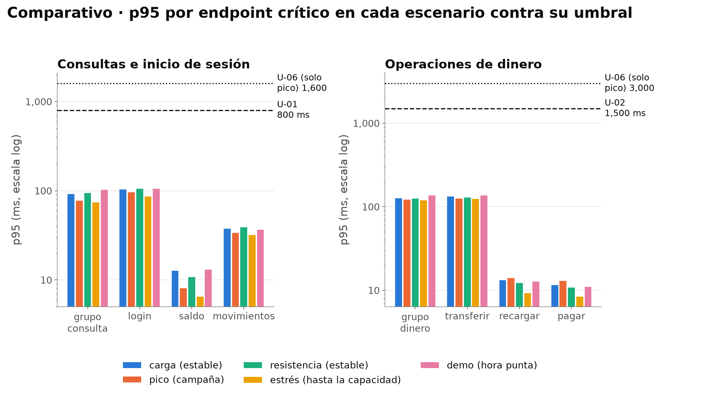

# Comparativo de escenarios

Última corrida de cada escenario: referencia `20261111-1828`, calibracion `20261111-1830`, carga `20261111-1833`, pico `20261111-1918`, estres `20261111-1940`, escalabilidad `20261111-2103`, resistencia `20261111-1958`, demo `20261111-2125`.

Umbral de error de rendimiento: ≤ 1 % (U-03). Capacidad U-08 en usuarios simultáneos.

## Veredicto por umbral y escenario

| ID | Criterio | referencia | calibracion | carga | pico | estres | escalabilidad | resistencia | demo |
|---|---|---|---|---|---|---|---|---|---|
| U-01 | Consultas e inicio de sesión: el 95 % en menos de 800 ms | NO APLICA | NO APLICA | ✓ PASA | NO APLICA | NO APLICA | NO APLICA | ✓ PASA | ✓ PASA |
| U-02 | Operaciones de dinero: el 95 % en menos de 1.5 s | NO APLICA | NO APLICA | ✓ PASA | NO APLICA | NO APLICA | NO APLICA | ✓ PASA | ✓ PASA |
| U-03 | En hora punta, no más del 1 % de operaciones fallidas | NO APLICA | NO APLICA | ✓ PASA | NO APLICA | NO APLICA | NO APLICA | ✓ PASA | ✓ PASA |
| U-04 | Sostener el volumen de la hora punta | NO APLICA | NO APLICA | ✓ PASA | NO APLICA | NO APLICA | NO APLICA | ✓ PASA | NO APLICA |
| U-05 | …sin acumular retrasos | NO APLICA | NO APLICA | ✓ PASA | NO APLICA | NO APLICA | NO APLICA | ✓ PASA | NO APLICA |
| U-06 | Campaña: degradación razonable del servicio | NO APLICA | NO APLICA | NO APLICA | ✓ PASA | NO APLICA | NO APLICA | NO APLICA | NO APLICA |
| U-07 | Ninguna operación de dinero a medias ni aplicada dos veces | ✓ PASA | ✓ PASA | ✓ PASA | ✓ PASA | ✓ PASA | ✓ PASA | ✓ PASA | ✓ PASA |
| U-08 | Hasta cuántos usuarios simultáneos podemos crecer | NO APLICA | NO APLICA | NO APLICA | NO APLICA | MEDIDO | MEDIDO | NO APLICA | NO APLICA |
| U-09 | Opera de 6:00 a 24:00 sin reinicios | NO APLICA | NO APLICA | NO APLICA | NO APLICA | NO APLICA | NO APLICA | ✓ PASA | NO APLICA |
| V-01 | CPU del generador k6 < 80 % (equipo: informativo) | ✓ PASA | ✓ PASA | ✓ PASA | ✓ PASA | ✓ PASA | ✓ PASA | ✓ PASA | ✓ PASA |
| V-02 | errores de datos (4xx de negocio) = 0 | ✓ PASA | ✓ PASA | ✓ PASA | ✓ PASA | ✓ PASA | ✓ PASA | ✓ PASA | ✓ PASA |
| V-03 | mezcla lograda a ± 2 pp | — | — | ✓ PASA | ✓ PASA | ✓ PASA | ✓ PASA | ✓ PASA | — |
| V-04 | equipo libre antes de empezar (CPU ocioso ≥ 65 %) | ✓ PASA | ✓ PASA | ✓ PASA | ✓ PASA | ✓ PASA | ✓ PASA | ✓ PASA | ✓ PASA |
| V-05 | base restaurada idéntica y cuota de CPU esperada | ✓ PASA | ✓ PASA | ✓ PASA | ✓ PASA | ✓ PASA | ✓ PASA | ✓ PASA | ✓ PASA |
| V-06 | con 1 VU, p95 ≤ 10 % del umbral | ✗ FALLA | — | — | — | — | — | — | — |
| V-07 | sin avisos 'Insufficient VUs' | — | — | ✓ PASA | — | — | — | ✓ PASA | — |

## Resumen por escenario

| Escenario | Corrida | Medido en | Peticiones | p95 consulta (ms) | p95 dinero (ms) | Error rend. (%) | Error datos (%) | Throughput máx. (req/s) | Simultáneos máx. | CPU Qolqe máx. (%) | RSS máx. (MB) | CPU equipo máx. (%) | Capacidad U-08 |
|---|---|---|---|---|---|---|---|---|---|---|---|---|---|
| referencia | 20261111-1828 | toda la corrida | 100 | 70 | 136 | 0.00 | 0.00 | 2 | 1 | 2.59 | 58 | 21.05 | — |
| calibracion | 20261111-1830 | toda la corrida | 470 | 81 | 137 | 0.00 | 0.00 | 4 | 1 | 5.40 | 58 | 26.45 | — |
| carga | 20261111-1833 | carga (estable) | 8,796 | 93 | 128 | 0.00 | 0.00 | 10 | 101 | 13.31 | 63 | 60.85 | — |
| pico | 20261111-1918 | pico (campaña) | 14,585 | 78 | 123 | 0.00 | 0.00 | 30 | 304 | 31.90 | 66 | 90.22 | — |
| estres | 20261111-1940 | estrés (hasta la capacidad) | 25,589 | 75 | 121 | 0.00 | 0.00 | 85 | 1,144 | 75.53 | 478 | 82.27 | 850 |
| escalabilidad | 20261111-2103 | estrés con 2 CPU (hasta la capacidad) | 55,536 | 73 | 119 | 0.00 | 0.00 | 130 | 1,656 | 112.83 | 719 | 42.60 | 1,300 |
| resistencia | 20261111-1958 | resistencia (estable) | 35,182 | 95 | 127 | 0.00 | 0.00 | 10 | 101 | 12.58 | 63 | 26.56 | — |
| demo | 20261111-2125 | demo (hora punta) | 430 | 103 | 138 | 0.00 | 0.00 | 24 | 134 | 63.39 | 110 | 28.13 | — |

